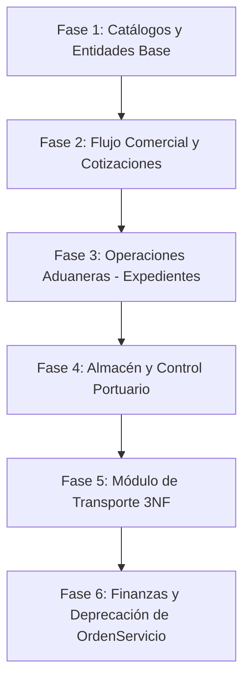

# Plan de Arquitectura y Construcción del Backend (SGA)
**Sistema de Gestión Aduanera y Logística Internacional**  
*Documento de Diseño Técnico y Especificación de APIs RESTful*

---

## 1. Visión General y Stack Tecnológico

El backend del SGA está construido sobre **Java 21** y **Spring Boot 4.1.x**, utilizando una arquitectura multicapa desacoplada y orientada al dominio. Toda la capa de persistencia se alineará con el nuevo modelo relacional normalizado (3NF) de [database/schema.sql](file:///home/jiodev/Documents/Proyects/SGA/database/schema.sql).

### Principios Fundamentales
* **Tolerancia Cero a Borrado Físico (Hard Delete):** Todas las operaciones de eliminación aplicarán **Borrado Lógico (Soft Delete)** modificando las banderas `estado_activo = false` o transicionando el estado del registro a `ANULADO` / `INACTIVO` para preservar la trazabilidad fiscal y auditorías aduaneras (SUNAT).
* **Endpoints Uniformes RESTful:** Convención estándar `/api/v1/{modulo}` con envoltura unificada de respuesta `ApiResponseDTO<T>`.
* **Desacoplamiento Estricto:** Entidades JPA independientes de los contratos HTTP mediante DTOs de petición (`RequestDTO`) con validaciones Jakarta (`@Valid`, `@NotBlank`, `@Positive`) y DTOs de respuesta (`ResponseDTO`).
* **Seguridad y Auditoría:** Autenticación Stateless basada en JWT, control de acceso por roles (`@PreAuthorize`) y sellado de fechas (`CURRENT_TIMESTAMP`).
uso de jasperreport
---

## 2. Estructura de Paquetes en Spring Boot

```
backend/src/main/java/pe/sga/
├── config/                  # Seguridad JWT, CORS, OpenApi/Swagger
├── controller/              # Controladores REST (/api/v1/...)
│   ├── auth/                # Autenticación y Perfil
│   ├── catalogos/           # Puertos, Tipos de Carga, Mercancías
│   ├── seguridad/           # Usuarios, Roles, Sedes
│   ├── comercial/           # Clientes, Cotizaciones
│   ├── operaciones/         # Expedientes Aduaneros (DAM, Canales)
│   ├── almacen/             # Depósitos Temporales, Balanza VGM
│   ├── transporte/          # Conductores, Unidades, Despachos
│   └── finanzas/            # Liquidación de Tributos y Gastos
├── dto/
│   ├── request/             # DTOs de entrada validados
│   └── response/            # DTOs de salida y ApiResponseDTO<T>
├── entity/                  # Entidades JPA (@Table, @Column, @ManyToOne)
│   └── enums/               # Enums (CanalSunat, EstadoCotizacion, etc.)
├── repository/              # Interfaces Spring Data JPA
├── service/                 # Interfaces de Servicios de Negocio
│   └── impl/                # Implementaciones transaccionales (@Transactional)
└── exception/               # GlobalExceptionHandler y excepciones custom
```

---

## 3. Matriz de Endpoints Estándar (CRUD + Borrado Lógico)

Todas las entidades expondrán el siguiente estándar de operaciones HTTP:

| Operación | Método HTTP | Ruta Relativa | Código Éxito | Acción / Comportamiento |
| :--- | :--- | :--- | :--- | :--- |
| **Listar Todos / Filtros** | `GET` | `/api/v1/{recurso}` | `200 OK` | Retorna lista con soporte de filtros (`soloActivos`, `buscar`, etc.) |
| **Obtener por ID** | `GET` | `/api/v1/{recurso}/{id}` | `200 OK` | Retorna detalle o `404 Not Found` |
| **Crear / Registrar** | `POST` | `/api/v1/{recurso}` | `201 CREATED` | Valida DTO, genera códigos únicos y persiste |
| **Actualizar / Editar** | `PUT` | `/api/v1/{recurso}/{id}` | `200 OK` | Actualización completa de campos modificables |
| **Borrado Lógico** | `DELETE` | `/api/v1/{recurso}/{id}` | `200 OK` | Setea `estado_activo = false` o `estado = 'ANULADO'` / `'INACTIVO'` |
| **Reactivación** | `PATCH` | `/api/v1/{recurso}/{id}/reactivar` | `200 OK` | Restaura `estado_activo = true` o `estado = 'ACTIVO'` |

---

## 4. Diseño Modular Detallado por Dominio

### 4.1. Catálogos Auxiliares
Permiten alimentar las listas desplegables y validar la carga en origen y aduanas.

* **`CatalogoMercanciaController` (`/api/v1/catalogos/mercancias`):**
  * `GET /`: Listar mercancías con filtros por `categoria`, `requierePermiso` y `soloActivos`.
  * `POST /`: Registrar nueva partida/mercancía (código único, arancel base, entidad reguladora como DIGEMID/SENASA).
  * `PUT /{id}`: Editar clasificación arancelaria o requisitos de permiso.
  * `DELETE /{id}`: Borrado lógico (`estado = 'INACTIVO'`).
  * `PATCH /{id}/reactivar`: Reactivar mercancía.

* **`CatalogoPuertoController` (`/api/v1/catalogos/puertos`):**
  * Ya implementado. Se mantiene con CRUD, filtro `soloActivos`, borrado lógico y exportación PDF en JasperReports.

* **`CatalogoTipoCargaController` (`/api/v1/catalogos/tipos-carga`):**
  * Simplificado según el nuevo esquema (código, nombre, descripción, estado).
  * CRUD completo con borrado lógico (`estado = 'INACTIVO'`).

---

### 4.2. Módulo de Seguridad y Maestros

* **`ClienteController` (`/api/v1/clientes`):**
  * `GET /`: Filtro por término (`buscar`), filtro `prospecto=true/false` y filtro `soloActivos`.
  * `POST /`: Alta de cliente o prospecto (con validación de RUC/DNI único).
  * `PUT /{id}`: Actualización de datos fiscales y contacto.
  * `PATCH /{id}/convertir-cliente`: Promueve un prospecto a cliente formal (`es_prospecto = false`).
  * `DELETE /{id}`: **Borrado lógico actualizado** (`estado_activo = false`).
  * `PATCH /{id}/reactivar`: Reactivación de cuenta cliente.

* **`UsuarioController`, `RolController`, `SedeController`:**
  * Mantienen su estructura existente con borrado lógico por `estado_activo` y `estado`.

---

### 4.3. Módulo Comercial (Cotizaciones)

* **`CotizacionController` (`/api/v1/cotizaciones`):**
  * `GET /`: Listado con filtros por `estado` (`PENDIENTE`, `APROBADA`, `OBSERVADA`, `RECHAZADA`, `ANULADA`), `idCliente`, rango de fechas.
  * `POST /`: Emisión de cotización por usuario comercial (asocia cliente, mercancía, tipo de carga, puertos, flete y honorarios).
  * `PUT /{id}`: Edición de montos y condiciones antes de revisión.
  * `PATCH /{id}/revision`: Endpoint exclusivo del **Agente Aduanero Revisor** para aprobar, observar (con motivo) o rechazar la cotización técnicamente.
  * `DELETE /{id}`: Borrado lógico por estado (`estado = 'ANULADA'`).

---

### 4.4. Módulo de Operaciones Aduaneras (Expedientes)
*Sustituye la antigua tabla simplificada `orden_servicio` por el flujo aduanero real.*

* **`ExpedienteController` (`/api/v1/expedientes`):**
  * `GET /`: Listar expedientes con filtros por `canalSunat` (`VERDE`, `NARANJA`, `ROJO`), `idAgenteAduanero`, `estadoExpediente`.
  * `GET /{id}`: Detalle completo del expediente con enlace a cotización, DAM y cliente.
  * `POST /`: Apertura de expediente aduanero a partir de una cotización aprobada (asigna código único de expediente y agente aduanero responsable).
  * `PUT /{id}`: Actualización de datos operativos (fechas ETD/ETA, contacto de proveedor/comprador exterior, contenedor y precinto).
  * `PATCH /{id}/canal`: Registro de canal asignado por SUNAT y numeración de DAM.
    * Si es **NARANJA / ROJO**: Activa automáticamente la bandera `notificado_agente = true` y fecha de notificación.
  * `PATCH /{id}/levante`: Registro de levante autorizado por aduanas y detalle de inspección.
  * `DELETE /{id}`: Borrado lógico (`estado_expediente = 'ANULADO'`).

---

### 4.5. Módulo de Almacén y Depósitos Temporales

* **`ControlAlmacenController` (`/api/v1/almacen`):**
  * `GET /`: Listar inventario en custodia con alerta de días libres próximos a vencer (`fecha_limite_retiro`).
  * `GET /expediente/{idExpediente}`: Consulta de almacén asociada al expediente.
  * `POST /`: Registro de ingreso a depósito temporal:
    * Si el canal aduanero fue **VERDE**: `tipo_ingreso = 'DIRECTO_VERDE'`.
    * Si fue **NARANJA/ROJO**: `tipo_ingreso = 'POST_INSPECCION'`.
    * Registra ticket de pesaje VGM, precinto y bultos.
  * `PUT /{id}`: Edición de ubicación de bahía o bultos.
  * `PATCH /{id}/autorizar-salida`: Valida pago y autoriza movimiento (`autorizado_movimiento = true`, registra `fecha_salida`).
  * `DELETE /{id}`: Borrado lógico (`estado_almacen = 'ANULADO'`).

---

### 4.6. Módulo de Transporte y Distribución Local (3NF)

* **`ConductorController` (`/api/v1/transporte/conductores`):**
  * `GET /`: Listar conductores (con filtro `soloActivos`).
  * `POST /`: Registrar chofer (valida brevete único MTC A-IIIc).
  * `PUT /{id}`: Editar datos de contacto y licencia.
  * `DELETE /{id}`: Borrado lógico (`estado_activo = false`).
  * `PATCH /{id}/reactivar`: Reactivar conductor.

* **`UnidadTransporteController` (`/api/v1/transporte/unidades`):**
  * `GET /`: Listar unidades con filtro por `estadoOperativo` (`DISPONIBLE`, `EN_RUTA`, `MANTENIMIENTO`) y `soloActivos`.
  * `POST /`: Registrar tracto/plataforma (valida placa única).
  * `PUT /{id}`: Actualizar características de carga y estado operativo.
  * `DELETE /{id}`: Borrado lógico (`estado_activo = false`).
  * `PATCH /{id}/reactivar`: Reactivar unidad.

* **`DespachoTransporteController` (`/api/v1/transporte/despachos`):**
  * `GET /`: Listar despachos con filtros por `estadoTransporte`, `codigoTracking` y rango de fechas programadas.
  * `POST /`: Programar traslado local para un expediente que cuenta con levante y salida de almacén autorizada.
  * `PATCH /{id}/asignar-recursos`: Asigna chofer (`id_conductor`) y camión (`id_unidad`) normalizados.
  * `PATCH /{id}/iniciar-ruta`: Cambia estado a `EN_RUTA`, genera guía de remisión electrónica y registra hora de salida.
  * `PATCH /{id}/confirmar-entrega`: Registra `fecha_entrega_conforme` y persona que recepciona.
  * `DELETE /{id}`: Borrado lógico (`estado_transporte = 'CANCELADO'`).

---

### 4.7. Módulo de Finanzas y Liquidación

* **`LiquidacionFinancieraController` (`/api/v1/finanzas/liquidaciones`):**
  * `GET /`: Listar liquidaciones con filtros por `estadoPago` (`PENDIENTE`, `PAGADO`, `ANULADO`).
  * `GET /expediente/{idExpediente}`: Obtener estado de cuenta de una operación.
  * `POST /`: Generar liquidación final consolidando:
    * Tributos SUNAT (Ad-valorem, IGV, IPM).
    * Gastos portuarios y almacén temporal.
    * Flete de transporte terrestre local.
    * Honorarios de la agencia de aduanas.
  * `PUT /{id}`: Ajustar cargos o tipo de cambio oficial.
  * `PATCH /{id}/registrar-pago`: Registra número de operación bancaria, comprobante/factura y pasa a `estado_pago = 'PAGADO'`.
  * `DELETE /{id}`: Borrado lógico (`estado_pago = 'ANULADO'`).

---

## 5. Estrategia de Migración y Deprecación de `OrdenServicio`

Dado que el nuevo flujo de negocio reemplaza formalmente la antigua entidad `orden_servicio` por `expediente` y `despacho_transporte`:

1. **Fase 1 (Coexistencia Transitoria):** Mantener las clases de `OrdenServicio` marcadas con la anotación `@Deprecated(since = "2.0", forRemoval = true)`.
2. **Fase 2 (Sustitución en Controladores):** Redirigir la lógica operativa de la frontend hacia los nuevos endpoints `/api/v1/expedientes` y `/api/v1/transporte/despachos`.
3. **Fase 3 (Limpieza Final):** Retirar `OrdenServicio.java`, su repositorio, servicio y controlador una vez que los nuevos módulos pasen las pruebas de integración.

---

## 6. Plan de Ejecución por Fases



### Detalle de Entregables por Fase:
* **Fase 1:**
  * Crear `CatalogoMercancia` (Entity, Repository, Service, Controller, DTOs).
  * Actualizar `CatalogoTipoCarga` (ajustar campos a nuevo esquema).
  * Actualizar `Cliente` (agregar `estado_activo`, implementar `DELETE` lógico y `reactivar`).
* **Fase 2:**
  * Actualizar `Cotizacion` (ajustar relación con `CatalogoMercancia`, `CatalogoTipoCarga`, estado `ANULADA` y workflow de revisión técnica).
* **Fase 3:**
  * Crear módulo `Expediente` (Entity, Repository, Service, Controller, DTOs, workflow de canales SUNAT y levante).
* **Fase 4:**
  * Crear módulo `ControlAlmacen` (Depósitos temporales, pesaje VGM, días libres, autorización de retiro).
* **Fase 5:**
  * Crear `Conductor` y `UnidadTransporte` con soft-delete.
  * Crear `DespachoTransporte` con tracking y flujo de asignación.
* **Fase 6:**
  * Crear `LiquidacionFinanciera` con desglose tributario y cobranza.
  * Deprecar y desmantelar `OrdenServicio`.
  * Pruebas completas mediante archivo `api-test.http`.
