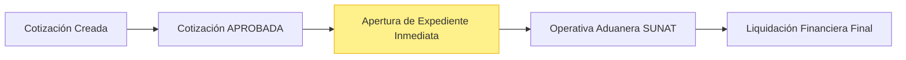
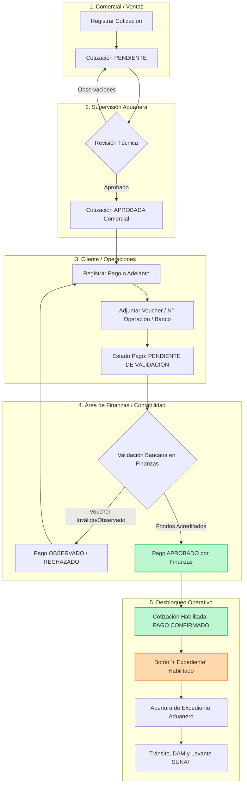
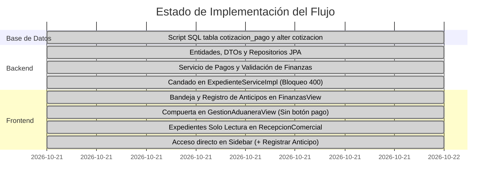

# INFORME TÉCNICO Y PROPUESTA DE ARQUITECTURA
## Reestructuración del Flujo Operativo: Aprobación de Cotización → Validación Financiera (Anticipo/Pago) → Apertura de Expediente Aduanero

**Proyecto:** SGA (Sistema de Gestión Aduanera y Logística Internacional)  
**Fecha:** 2026-10-20  
**Versión:** 1.0  
**Estado:** Propuesta de Diseño Técnico y Arquitectura  

---

## 1. Diagnóstico del Flujo Actual vs. Nuevo Flujo Requerido

### 1.1. Situación Actual
Actualmente, el ciclo de vida entre la cotización y el expediente opera de manera directa sin compuerta financiera previa:
1. **Comercial:** Emite la cotización en estado `PENDIENTE`.
2. **Agente Aduanero / Supervisor:** Revisa técnicamente la cotización y la pasa a `APROBADA`.
3. **Apertura Inmediata:** Cualquier cotización en estado `APROBADA` permite aperturar un expediente (`POST /api/v1/expedientes`) sin requerir comprobante ni visto bueno de caja.
4. **Finanzas Tardío:** El área de Finanzas interviene recién al cierre de la operación mediante la `LiquidacionFinanciera`.



### 1.2. Problemática Operativa
- **Riesgo Crediticio / Operacional:** En operaciones de comercio exterior (aduanas, flete internacional, almacenaje portuario y derechos arancelarios SUNAT), la agencia asume compromisos económicos y horas de agentes aduaneros antes de confirmar que el cliente depositó la provisión de fondos o el anticipo comercial acordado.
- **Falta de Trazabilidad Bancaria:** No existe registro previo de vouchers, bancos receptores ni números de operación en la etapa preliminar.

---

### 1.3. Nuevo Flujo Propuesto con Compuerta Financiera



---

## 2. Definición del Modelo de Negocio: Pago vs. Adelanto

Para agencias aduaneras y operadores logísticos, el cobro preliminar suele tener dos modalidades configurables:

| Modalidad | Descripción | Criterio de Aprobación en Finanzas |
| :--- | :--- | :--- |
| **Adelanto / Anticipo (Provisión de Fondos)** | El cliente abona un porcentaje (ej. 30%, 50% o el 100% de tributos y honorarios estimados) para iniciar el trámite aduanero. | Finanzas valida el abono bancario mínimo requerido. |
| **Pago Total (100%)** | El cliente cancela la totalidad de la cotización previo a la movilización de carga. | Finanzas valida que el monto recibido cubra el total cotizado. |
| **Crédito / Carta Fianza (Excepción Corporativa)** | Para clientes calificados con línea de crédito aduanera activa. | Finanzas aprueba la liberación del expediente marcando "Línea de Crédito Autorizada". |

> **Nota Clave:** Todo anticipo registrado en esta etapa inicial se **descuenta automáticamente** en la `LiquidacionFinanciera` final del expediente aduanero como `anticipo_previo_pen` o `anticipo_previo_usd`, evitando duplicidad de cobranzas.

---

## 3. Arquitectura Técnica y Modelo de Datos

### 3.1. Nueva Tabla: `cotizacion_pago`
Permite trazabilidad completa, múltiples abonos si el cliente paga en partes, soporte de comprobantes adjuntos y auditoría por usuario de finanzas.

```sql
CREATE TABLE cotizacion_pago (
    id_pago INT NOT NULL AUTO_INCREMENT,
    id_cotizacion INT NOT NULL,
    codigo_pago VARCHAR(30) NOT NULL,            -- Ej: PAG-COT-2026-0001
    tipo_abono VARCHAR(30) NOT NULL DEFAULT 'ADELANTO', -- ADELANTO, PAGO_TOTAL, GARANTIA_CREDITO
    monto_abonado DECIMAL(12, 2) NOT NULL,
    moneda VARCHAR(5) NOT NULL DEFAULT 'USD',     -- USD o PEN
    tipo_cambio DECIMAL(8, 4) NOT NULL DEFAULT 3.7500,
    monto_equivalente_pen DECIMAL(12, 2) NOT NULL,
    metodo_pago VARCHAR(50) NOT NULL,             -- TRANSFERENCIA_BANCARIA, DEPOSITO_VENTANILLA, CHEQUE, etc.
    banco_origen VARCHAR(80) NULL,
    banco_destino VARCHAR(80) NOT NULL,           -- Ej: BCP Dólares, BBVA Soles
    numero_operacion VARCHAR(60) NOT NULL,        -- N° de Operación Bancaria
    fecha_operacion DATE NOT NULL,
    id_documento_comprobante INT NULL,            -- FK a documento_adjunto (Voucher PDF/JPG)
    
    -- Flujo de Aprobación por Finanzas
    estado_pago VARCHAR(25) NOT NULL DEFAULT 'PENDIENTE_REVISION', -- PENDIENTE_REVISION, APROBADO, OBSERVADO, RECHAZADO
    id_usuario_finanzas INT NULL,                 -- Usuario que validó en Finanzas
    fecha_validacion DATETIME NULL,
    observacion_finanzas TEXT NULL,
    
    -- Auditoría
    id_usuario_registro INT NOT NULL,             -- Usuario Comercial o Cliente que registró el voucher
    fecha_registro DATETIME NOT NULL DEFAULT CURRENT_TIMESTAMP,

    PRIMARY KEY (id_pago),
    CONSTRAINT uq_cotizacion_pago_codigo UNIQUE (codigo_pago),
    CONSTRAINT fk_pago_cotizacion FOREIGN KEY (id_cotizacion) REFERENCES cotizacion (id_cotizacion) ON UPDATE CASCADE ON DELETE RESTRICT,
    CONSTRAINT fk_pago_usuario_finanzas FOREIGN KEY (id_usuario_finanzas) REFERENCES usuario (id_usuario) ON UPDATE CASCADE ON DELETE SET NULL,
    CONSTRAINT fk_pago_usuario_registro FOREIGN KEY (id_usuario_registro) REFERENCES usuario (id_usuario) ON UPDATE CASCADE ON DELETE RESTRICT,
    CONSTRAINT fk_pago_doc_comprobante FOREIGN KEY (id_documento_comprobante) REFERENCES documento_adjunto (id_documento) ON UPDATE CASCADE ON DELETE SET NULL
) ENGINE = InnoDB DEFAULT CHARSET = utf8mb4 COLLATE = utf8mb4_unicode_ci;

CREATE INDEX idx_pago_cotizacion_estado ON cotizacion_pago (id_cotizacion, estado_pago);
```

### 3.2. Actualización de la Tabla `cotizacion`
Se añaden columnas de control financiero en `cotizacion` para consultas ágiles:

```sql
ALTER TABLE cotizacion
ADD COLUMN estado_pago VARCHAR(25) NOT NULL DEFAULT 'SIN_PAGO',
-- Estados: SIN_PAGO, PENDIENTE_REVISION, ADELANTO_APROBADO, PAGADO_TOTAL, OBSERVADO
ADD COLUMN total_abonado DECIMAL(12, 2) NOT NULL DEFAULT 0.00,
ADD COLUMN saldo_pendiente DECIMAL(12, 2) NOT NULL DEFAULT 0.00;
```

---

## 4. Diseño del Backend (Spring Boot 4.1.x / Java 21)

### 4.1. Nuevos DTOs y Entidad
1. **Entidad JPA:** `pe.sga.entity.CotizacionPago`
2. **Enums:**
   - `TipoAbonoCotizacion`: `ADELANTO`, `PAGO_TOTAL`, `LINEA_CREDITO`.
   - `EstadoPagoCotizacion`: `PENDIENTE_REVISION`, `APROBADO`, `OBSERVADO`, `RECHAZADO`.
3. **DTOs de Entrada:**
   - `CotizacionPagoRegistrarDTO`: `idCotizacion`, `tipoAbono`, `montoAbonado`, `moneda`, `bancoDestino`, `numeroOperacion`, `fechaOperacion`, `voucherBase64` / multipart file.
   - `CotizacionPagoValidarDTO`: `idPago`, `accion` (`APROBAR`, `OBSERVAR`), `motivoObservacion`.

### 4.2. Endpoints REST a incorporar

| Método | Endpoint | Rol Autorizado | Función |
| :--- | :--- | :--- | :--- |
| `POST` | `/api/v1/cotizaciones/{id}/pagos` | `VENTAS`, `ADMINISTRADOR` | Registra el adelanto/pago y adjunta voucher |
| `GET` | `/api/v1/cotizaciones/{id}/pagos` | Todos | Lista el historial de abonos de la cotización |
| `GET` | `/api/v1/finanzas/anticipos/pendientes` | `FINANZAS`, `CONTADOR`, `ADMIN` | Bandeja de Finanzas: Pagos pendientes de validación |
| `PATCH` | `/api/v1/finanzas/anticipos/{idPago}/validar` | `FINANZAS`, `CONTADOR`, `ADMIN` | Finanzas aprueba u observa el abono |

### 4.3. Candado Estricto de Creación de Expediente (`ExpedienteServiceImpl`)
En `ExpedienteServiceImpl.java`, se actualiza la validación previa al guardado:

```java
// Validación técnica previa existente
if (cotizacion.getEstado() != EstadoCotizacion.APROBADA) {
    throw new BadRequestException("La cotización debe estar APROBADA técnicamente.");
}

// NUEVA COMPUERTA FINANCIERA:
boolean tienePagoAprobado = cotizacionPagoRepository.existsByCotizacion_IdCotizacionAndEstadoPago(
    cotizacion.getIdCotizacion(),
    EstadoPagoCotizacion.APROBADO
);

if (!tienePagoAprobado) {
    throw new BadRequestException("No es posible aperturar el expediente. Se requiere al menos un pago o adelanto validado y aprobado por Finanzas.");
}
```

---

## 5. Diseño del Frontend (Vue 3 + PrimeVue)

### 5.1. Módulo de Finanzas: "Anticipos Pre-Expediente" (Centralización de Pagos)
En `FinanzasView.vue`, se incorporó la pestaña y módulo integral de control de pagos:
- **Botón `+ Registrar Anticipo / Pago`:** Permite a Tesorería / Finanzas seleccionar cualquier cotización comercial aprobada que cuente con saldo pendiente de pago.
- **Formulario Modal de Pago (`RegistrarPagoModal.vue`):**
  - Selector de cotización activa con saldo en tiempo real.
  - Modalidad (Adelanto 30%, 50%, Pago Total 100%, Línea de Crédito / Fianza).
  - Moneda (USD / PEN), Tipo de cambio oficial y cálculo equivalente en soles.
  - Selección de cuenta bancaria receptora (BCP, BBVA, Interbank, Scotiabank).
  - N° de Operación bancaria, banco emisor del cliente y fecha del depósito.
  - Subida directa del comprobante bancario (Voucher / Boleta) en PDF o imagen.
- **Acciones de Auditoría Financiera:**
  - Botón **"Ver Voucher"** (abre el comprobante sustentatorio).
  - Botón **"Aprobar"** (sella la conformidad bancaria con el usuario actual de Finanzas y desbloquea el expediente).
  - Botón **"Observar"** (permite ingresar motivo de discrepancia para corrección).

### 5.2. Supervisión Aduanera (`GestionAduaneraView.vue`)
- **Segregación Estricta:** Se retiró el botón de registrar pago; Supervisión Aduanera no cobra ni registra abonos bancarios.
- **Estado Financiero Visible:** Muestra badges informativos del estado del pago (`Pendiente de Pago en Finanzas`, `Anticipo Aprobado`).
- **Bloqueo / Desbloqueo del Botón `+ Expediente`:**
  - Si la cotización está `APROBADA` pero no tiene pago validado por Finanzas:
    - El botón `+ Expediente` permanece bloqueado (`disabled`) con tooltip explicativo.
  - Si Finanzas aprueba el pago:
    - El botón `+ Expediente` se desbloquea en tono cobrizo cálido para iniciar la formalización aduanera.

### 5.3. Recepción Comercial (`RecepcionComercialView.vue`)
- **Foco Principal:** Gestión y seguimiento de propuestas y cotizaciones comerciales generales.
- **Bitácora de Expedientes Aduaneros (Modo Solo Lectura):**
  - Muestra la totalidad de expedientes en todos sus estados (`ASIGNADO`, `NUMERADO`, `EN_TRAMITE`, `CON_CANAL`, `LEVANTE_AUTORIZADO`, `CONCLUIDO`, `ANULADO`).
  - **Sin acciones de modificación:** Se eliminaron botones operativos (*Iniciar Operación*, *Concluir*, *Eliminar*) para preservar la integridad operativa del despacho aduanero y brindar a Comercial una herramienta 100% de monitoreo de cara al cliente.

---

## 6. Estado de la Implementación (Rama: `implementacion-final`)



### Resumen de Beneficios
1. **Control de Caja 100% Blindado:** Ningún agente aduanero iniciará operaciones ni devengará gastos de almacenaje/flete sin respaldo financiero real y aprobado por Finanzas.
2. **Segregación de Funciones:** Ventas cotiza y da seguimiento a expedientes, Supervisión audita técnicamente, Finanzas administra cobranzas y valida fondos, y Agente Aduanero opera.
3. **Trazabilidad Impecable:** Bitácora completa de números de operación bancaria, vouchers adjuntos y usuario responsable de la validación contable.
