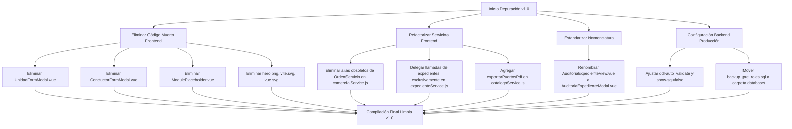

# Informe Técnico de Depuración y Auditoría Integral del Sistema SGA (v1.0)
**Sistema de Gestión Aduanera y Logística Internacional**  
*Fecha de Auditoría: 21 de Octubre de 2026*  
*Estado de Compilación:* **Backend: PASS (Maven/Java 21)** | **Frontend: PASS (Vite/Vue 3)**

---

## 1. Resumen Ejecutivo

El presente informe constituye una auditoría técnica profunda y exhaustiva de todo el código fuente del sistema **SGA**, abarcando tanto el **Backend (Spring Boot 4.1.x / Java 21)** como el **Frontend (Vue 3 / Vite)** y la base de datos relacional (**MySQL InnoDB**).

El objetivo principal es asegurar que el proyecto se encuentre depurado, sin código muerto, sin duplicidades innecesarias y completamente alineado entre capas para el **lanzamiento oficial de la Versión 1.0 (v1.0)**.

### Indicadores Clave de la Auditoría

| Métrica / Dimensión | Backend | Frontend | Estado / Diagnóstico |
| :--- | :---: | :---: | :--- |
| **Compilación y Build** | BUILD SUCCESS (0 errores) | BUILD SUCCESS (0 errores) | ✅ Ambos entornos compilan en limpio |
| **Endpoints REST Totales** | 126 endpoints | 137 llamadas `apiClient` | ℹ️ Inventario 100% catalogado |
| **Endpoints Consumidos en Frontend** | 120 endpoints (95.2%) | 120 endpoints | ✅ Integración funcional casi total |
| **Endpoints Backend no consumidos** | 6 endpoints (4.8%) | — | ⚠️ 5 del CRUD de Roles + 1 Healthcheck DevOps |
| **Llamadas Frontend huérfanas (404)** | 0 llamadas | 0 llamadas | ✅ Cero rutas rotas hacia el backend |
| **Entidades vs Tablas BD** | 16 entidades JPA | 16 tablas relacionales | ✅ Mapeo 1:1 idéntico y normalizado |
| **Roles Institucionales** | 8 roles | 8 roles | ✅ Consistencia perfecta BD/Java/Vue |
| **Componentes Vue Huérfanos** | — | 3 componentes | ⚠️ 2 modales no vinculados + 1 placeholder |
| **Assets / Archivos Obsoletos** | — | 3 archivos | ⚠️ 3 imágenes/SVG de plantilla sin uso |
| **Servicios Frontend con Redundancia** | — | 5 servicios | ⚠️ Duplicidad en Catálogos y Operaciones |

---

## 2. Matriz Exhaustiva de Endpoints: Backend vs Frontend

Se auditaron los **19 controladores** del backend y todas las llamadas HTTP generadas por la capa de servicios y vistas del frontend.

### 2.1 Resumen de Consumo por Módulo

| Módulo / Controlador | Endpoints Totales | Consumidos por Frontend | No Consumidos en UI | Servicio Frontend Asociado |
| :--- | :---: | :---: | :---: | :--- |
| **1. Auth (`AuthController`)** | 2 | 2 (100%) | 0 | `authService.js` |
| **2. Admin Logs (`AdminLogsController`)** | 3 | 3 (100%) | 0 | `logsService.js` |
| **3. Catálogo Puertos (`CatalogoPuertoController`)** | 6 | 6 (100%) | 0 | `catalogoService.js` + Vistas directas |
| **4. Catálogo Tipos Carga (`CatalogoTipoCargaController`)** | 6 | 6 (100%) | 0 | `catalogoService.js` |
| **5. Catálogo Mercancías (`CatalogoMercanciaController`)** | 7 | 7 (100%) | 0 | `mercanciaService.js` / `catalogoService.js` |
| **6. Clientes (`ClienteController`)** | 8 | 8 (100%) | 0 | `comercialService.js` |
| **7. Cotizaciones (`CotizacionController`)** | 8 | 8 (100%) | 0 | `comercialService.js` / `gestionAduaneraService.js` |
| **8. Pagos & Anticipos (`CotizacionPagoController`)** | 6 | 6 (100%) | 0 | `comercialService.js` / `finanzasService.js` |
| **9. Expedientes Aduaneros (`ExpedienteController`)** | 9 | 9 (100%) | 0 | `expedienteService.js` / `gestionAduaneraService.js` |
| **10. Almacén & Depósito (`ControlAlmacenController`)** | 7 | 7 (100%) | 0 | `almacenService.js` |
| **11. Conductores MTC (`ConductorController`)** | 7 | 7 (100%) | 0 | `transporteFlotaService.js` |
| **12. Unidades de Flota (`UnidadTransporteController`)** | 7 | 7 (100%) | 0 | `transporteFlotaService.js` |
| **13. Despacho & Tracking (`DespachoTransporteController`)** | 12 | 12 (100%) | 0 | `transporteFlotaService.js` |
| **14. Liquidaciones (`LiquidacionFinancieraController`)** | 10 | 10 (100%) | 0 | `finanzasService.js` |
| **15. Sedes Territoriales (`SedeController`)** | 7 | 7 (100%) | 0 | `sedeService.js` |
| **16. Usuarios TI (`UsuarioController`)** | 7 | 7 (100%) | 0 | `userService.js` |
| **17. Documentos Adjuntos (`DocumentoController`)** | 6 | 6 (100%) | 0 | `documentoService.js` |
| **18. Roles del Sistema (`RolController`)** | 6 | 1 (16.7%) | 5 | `userService.js` |
| **19. Healthcheck (`HealthController`)** | 1 | 0 (0.0%) | 1 | Endpoint de infraestructura DevOps |
| **TOTAL** | **126** | **120** | **6** | — |

---

### 2.2 Detalle de los 6 Endpoints Backend No Consumidos por el Frontend

Los siguientes endpoints están codificados y operativos en el backend, pero **no disponen de interfaz gráfica o llamada activa en el frontend**:

| Método | Endpoint Backend | Controlador :: Método | Motivo / Diagnóstico |
| :---: | :--- | :--- | :--- |
| `GET` | `/api/v1/health` | `HealthController::checkHealth` | **Normal.** Endpoint técnico para balanceadores, Docker o monitoreo uptime. No requiere UI en el frontend. |
| `POST` | `/api/v1/roles` | `RolController::crear` | **Sin UI.** El sistema utiliza 8 roles estáticos institucionales fijados por enum (`RolUsuario.java`). No existe pantalla para crear roles dinámicos en el frontend. |
| `GET` | `/api/v1/roles/{id}` | `RolController::buscarPorId` | **Sin UI.** No se consulta el rol por ID de manera individual en ninguna vista. |
| `PUT` | `/api/v1/roles/{id}` | `RolController::actualizar` | **Sin UI.** No existe formulario ni opción para renombrar o modificar roles institucionales. |
| `DELETE` | `/api/v1/roles/{id}` | `RolController::eliminarPorEstado` | **Sin UI.** No se permite la eliminación de roles del sistema desde la interfaz web. |
| `PATCH` | `/api/v1/roles/{id}/reactivar` | `RolController::reactivar` | **Sin UI.** Al no eliminarse roles, no se requiere reactivación desde la interfaz. |

> [!NOTE]
> **Dictamen sobre `RolController`:** El frontend únicamente consume `GET /api/v1/roles` (a través de `userService.getRoles()`) para llenar el `<select>` de roles al dar de alta o editar un usuario en `UserRegistrationForm.vue`. Mantener los métodos de escritura en `RolController` no genera daño técnico, pero si no se contempla un módulo de parametrización de roles en v1.0, deben considerarse endpoints cerrados o reservados para el Administrador de Base de Datos / TI.

---

## 3. Depuración del Frontend: Código Muerto y Archivos Huérfanos

La auditoría de dependencias y referencias en `frontend/src` identificó varios componentes y recursos que no son utilizados en ninguna ruta, vista o componente padre:

### 3.1 Componentes Vue Huérfanos (0 Referencias)

1. **`frontend/src/features/roles-modules/components/UnidadFormModal.vue`**
   * **Problema:** Este componente modal fue creado para registrar y editar unidades vehiculares usando `BaseModal.vue`. Sin embargo, la vista principal `GerenciaFlotaView.vue` reimplementó el formulario completo de la unidad directamente en su propio archivo utilizando el `<Dialog>` de PrimeVue.
   * **Consecuencia:** `UnidadFormModal.vue` está completamente desconectado del árbol de componentes.
   * **Acción recomendada:** Eliminar este archivo para evitar duplicidad y mantener una sola fuente de la verdad en `GerenciaFlotaView.vue`.

2. **`frontend/src/features/roles-modules/components/ConductorFormModal.vue`**
   * **Problema:** Similar al caso anterior; este componente modal fue creado para el registro y edición de conductores MTC. La vista `GerenciaConductoresView.vue` implementó su propio modal interno de alta y edición con PrimeVue `<Dialog>`.
   * **Consecuencia:** `ConductorFormModal.vue` es código muerto sin importación alguna.
   * **Acción recomendada:** Eliminar este archivo.

3. **`frontend/src/shared/components/ModulePlaceholder.vue`**
   * **Problema:** Componente de relleno (*placeholder*) utilizado durante las etapas iniciales de maquetación cuando las vistas de los roles aún no estaban desarrolladas.
   * **Consecuencia:** Todos los módulos (00 al 07) cuentan hoy con vistas 100% implementadas y funcionales; `ModulePlaceholder.vue` no es importado en ningún punto del sistema.
   * **Acción recomendada:** Eliminar este archivo.

---

### 3.2 Archivos de Assets Obsoletos

1. **`frontend/src/assets/hero.png`** (0 referencias): Imagen no utilizada por ningún componente del sistema. Los héroes de pantalla utilizan el componente estilizado `HeroBannerCard.vue`.
2. **`frontend/src/assets/vite.svg`** (0 referencias): Archivo remanente del generador base de Vite. El favicon del sistema ya apunta a `/favicon.svg` en `public/`.
3. **`frontend/src/assets/vue.svg`** (0 referencias): Archivo remanente del generador base de Vue.
* **Acción recomendada:** Eliminar estos 3 archivos del directorio `frontend/src/assets/`.

---

### 3.3 Inconsistencia en la Nomenclatura de Componentes

* **`frontend/src/features/roles-modules/components/AuditoriaExpedienteView.vue`**:
  * **Problema:** Termina con el sufijo `View.vue` (que por convención estándar de Vue/Vite identifica una página/pantalla enrutada en el router), pero se encuentra dentro de `components/` y funciona como un subcomponente/modal invocado únicamente desde `GestionAduaneraView.vue`.
  * Además, coexiste con `LegalAuditoriaView.vue` (que sí es una vista de ruta en `views/`), lo que genera confusión técnica al buscar archivos.
  * **Acción recomendada:** Renombrar a `AuditoriaExpedienteModal.vue` o `AuditoriaExpedientePanel.vue`.

---

## 4. Auditoría de Duplicación y Redundancia en la Capa de Servicios

Se detectaron solapamientos y duplicidades significativas entre los servicios HTTP en `frontend/src`:

### 4.1 Duplicación: `catalogoService.js` vs `mercanciaService.js`

* En `catalogoService.js` se definen:
  * `getMercancias(soloActivos, categoria)` -> Retorna `response.data` (`ApiResponseDTO`).
  * `getMercanciaById(id)` -> Retorna `response.data`.
* En `mercanciaService.js` se definen:
  * CRUD completo de mercancías (`getMercancias`, `getMercanciaById`, `getMercanciaByCodigo`, `createMercancia`, `updateMercancia`, `deleteMercancia`, `reactivarMercancia`), pero retorna `response.data.data` (desempaqueta el contenido directamente).
* **Impacto en el código:**
  * `CatalogosManagementView.vue` importa `mercanciaService` para listar y eliminar mercancías.
  * `CotizacionRegistrationForm.vue` (L1286) importa `catalogoService` y ejecuta `catalogoService.getMercancias(true)`.
  * Existe una disparidad en la convención de retorno (`response.data` vs `response.data.data`) que obligó a programar funciones defensivas como `unwrapList()` en los formularios.
* **Acción recomendada:** Unificar la gestión de mercancías en `mercanciaService.js` o integrar todo el catálogo dentro de `catalogoService.js`, estandarizando que todos los servicios retornen siempre `response.data.data`.

---

### 4.2 Duplicación: `comercialService.js` vs `gestionAduaneraService.js` vs `expedienteService.js`

Existe una superposición de métodos que apuntan a los mismos endpoints del backend:

```
[Endpoint Backend]                     [Servicios Frontend que lo implementan]
/api/v1/cotizaciones                   -> comercialService.getCotizaciones
                                       -> gestionAduaneraService.getCotizaciones (DUPLICADO)

/api/v1/cotizaciones/{id}/revision     -> comercialService.revisarCotizacion
                                       -> gestionAduaneraService.revisarCotizacion (DUPLICADO)

/api/v1/expedientes                    -> expedienteService.getExpedientes
                                       -> gestionAduaneraService.getExpedientes (DUPLICADO)

/api/v1/expedientes (POST)             -> expedienteService.createExpediente
                                       -> comercialService.createExpediente (DUPLICADO)
                                       -> comercialService.createOrdenServicio (ALIAS OBSOLETO)
                                       -> gestionAduaneraService.crearExpediente (DUPLICADO NO USADO)

/api/v1/expedientes/{id}/canal         -> expedienteService.asignarCanal
                                       -> gestionAduaneraService.asignarCanal (DUPLICADO)

/api/v1/expedientes/{id}/levante       -> expedienteService.autorizarLevante
                                       -> gestionAduaneraService.autorizarLevante (DUPLICADO)
```

* **Alias obsoletos en `comercialService.js`:**
  * `createOrdenServicio(data)` (L122-124)
  * `updateOrdenServicioEstado(id, data)` (L126-128)
  * `deleteOrdenServicio(id)` (L130-132)
  * Estos 3 métodos son reminiscencias del modelo anterior donde los expedientes se llamaban «órdenes de servicio». Ningún componente del sistema los invoca.
* **Acción recomendada:**
  1. Eliminar los alias obsoletos en `comercialService.js`.
  2. Centralizar todas las operaciones de expedientes en `expedienteService.js`.
  3. Dejar en `comercialService.js` únicamente Clientes, Cotizaciones y Pagos de Cotización.
  4. Rediseñar `gestionAduaneraService.js` para que importe y re-exporte o delegue en `expedienteService.js` y `comercialService.js` en vez de reescribir llamadas axios manuales.

---

### 4.3 Inconsistencia en la Exportación a PDF de Catálogos

* Para **Usuarios**: La exportación se consume mediante `userService.exportarUsuariosPdf()` con descarga centralizada vía `download.js`.
* Para **Sedes**: La exportación se consume mediante `sedeService.exportarSedesPdf()` con descarga centralizada vía `download.js`.
* Para **Puertos**: `CatalogosManagementView.vue` (L631) y `AdminOverviewView.vue` (L327) saltan la capa de servicios e invocan directamente `apiClient.get('/catalogos/puertos/exportar-pdf', { responseType: 'blob' })`.
* **Acción recomendada:** Agregar el método formal `exportarPuertosPdf()` dentro de `catalogoService.js` para mantener la arquitectura limpia y uniforme.

---

## 5. Depuración del Backend: Código, Métodos y Buenas Prácticas

### 5.1 Métodos de Servicio no Invocados

* **`IUsuarioService::buscarPorUsername(String username)`**:
  * Declarado en la interfaz `IUsuarioService.java` (L21) e implementado en `UsuarioServiceImpl.java` (L97).
  * No está expuesto en `UsuarioController` ni es llamado por ningún otro servicio (la autenticación JWT resuelve al usuario mediante `UserDetails` y la consulta directa al repositorio `UsuarioRepository.findByUsername`).
  * **Acción recomendada:** Si no se expondrá un endpoint `/api/v1/usuarios/username/{username}`, este método puede mantenerse como utilidad interna o documentarse como método de consulta auxiliar.

### 5.2 Parámetro de Búsqueda de Mercancías (`soloActivos` vs `soloActivas`)

* En `CatalogoMercanciaController.java` (L24), el controlador define:
  ```java
  @RequestParam(required = false, defaultValue = "false") boolean soloActivos
  ```
* En `mercanciaService.js` (L6), la documentación JSDoc y algunos comentarios sugerían `soloActivas`.
* **Revisión:** Afortunadamente, en la invocación de `catalogoService.getMercancias(true)` se pasa `soloActivos` correctamente. Se debe mantener vigilancia para que en todo el frontend se use `soloActivos` (masculino estándar de la API).

---

## 6. Estado de Base de Datos, Entidades y Seguridad

### 6.1 Mapeo de Entidades vs Tablas Relacionales

Se contrastó el esquema formal `database/schema.sql` con las entidades JPA en `pe.sga.entity`:

| # | Tabla en Base de Datos | Entidad JPA en Backend | Estado de Mapeo | Borrado Lógico Aplicado |
| :-: | :--- | :--- | :---: | :--- |
| 1 | `catalogo_puerto` | `CatalogoPuerto.java` | 100% idéntico | `estado = 'INACTIVO'` |
| 2 | `catalogo_tipo_carga` | `CatalogoTipoCarga.java` | 100% idéntico | `estado = 'INACTIVO'` |
| 3 | `catalogo_mercancia` | `CatalogoMercancia.java` | 100% idéntico | `estado = 'INACTIVO'` |
| 4 | `rol` | `Rol.java` | 100% idéntico | `estado_activo = false` |
| 5 | `sede` | `Sede.java` | 100% idéntico | `estado_activo = false` |
| 6 | `usuario` | `Usuario.java` | 100% idéntico | `estado_activo = false` |
| 7 | `cliente` | `Cliente.java` | 100% idéntico | `estado_activo = false` |
| 8 | `cotizacion` | `Cotizacion.java` | 100% idéntico | `estado = 'ANULADA'` |
| 9 | `cotizacion_pago` | `CotizacionPago.java` | 100% idéntico | `estado_pago = 'RECHAZADO'` |
| 10 | `expediente` | `Expediente.java` | 100% idéntico | `estado_expediente = 'ANULADO'` |
| 11 | `control_almacen` | `ControlAlmacen.java` | 100% idéntico | `estado_activo = false` |
| 12 | `conductor` | `Conductor.java` | 100% idéntico | `estado_activo = false` |
| 13 | `unidad_transporte` | `UnidadTransporte.java` | 100% idéntico | `estado_activo = false` |
| 14 | `despacho_transporte` | `DespachoTransporte.java` | 100% idéntico | `estado_transporte = 'CANCELADO'` |
| 15 | `liquidacion_financiera` | `LiquidacionFinanciera.java` | 100% idéntico | `estado_pago = 'ANULADO'` |
| 16 | `documento_adjunto` | `DocumentoAdjunto.java` | 100% idéntico | `estado_activo = false` |

> **Diagnóstico:** Cumplimiento total del principio de **Tolerancia Cero a Borrado Físico (Hard Delete)**. Ninguna tabla del sistema ejecuta sentencias `DELETE` destructivas en producción, garantizando la trazabilidad fiscal y auditoría aduanera.

---

### 6.2 Matriz de Roles y Control de Acceso

Los **8 roles institucionales definitivos** están alineados entre la base de datos (`rol.nombre_rol`), el backend (`RolUsuario.java` y `SecurityRoles.java`) y el frontend (`roles.js` y guards del router):

```
1. ADMINISTRADOR_TI      -> Módulo 00 (Administración TI: Usuarios, Logs, Acerca de)
2. GERENTE_GENERAL       -> Módulo 01 (Gerencia General: Sedes, Catálogos, Flota, Conductores, Resumen)
3. AGENTE_COMERCIAL      -> Módulo 02 (Recepción Comercial: Clientes, Cotizaciones, Pre-expedientes)
4. SUPERVISOR_ADUANERO   -> Módulo 03 (Gestión Aduanera: Auditoría, Asignación de Canal, Declaraciones DAM)
5. AGENTE_ADUANERO       -> Módulo 04 (Agente Aduanero: Depósito Temporal, Balanza VGM, Salidas)
6. SUPERVISOR_TRANSPORTE -> Módulo 05 (Transporte y Flota: Cabina Operativa, Despachos, Rutas, Incidencias)
7. CONTADOR              -> Módulo 06 (Finanzas: Liquidación de Cuentas, Facturación, Validación de Anticipos)
8. ASESOR_LEGAL          -> Módulo 07 (Legal y Auditoría: Monitoreo Documental, Contratos, Contingencias)
```

* **Permisos Especiales:** Los roles `ADMINISTRADOR_TI` y `GERENTE_GENERAL` tienen concedido acceso de conmutación total a todos los módulos desde el selector de la barra lateral (`AppSidebar.vue`).

---

## 7. Ajustes Requeridos para Despliegue en Producción (v1.0)

Antes de realizar el empaquetado final (`mvn clean package` y despliegue a servidor), deben revisarse los siguientes parámetros de configuración en el Backend:

1. **`spring.jpa.hibernate.ddl-auto` (`application.properties`):**
   * *Valor actual:* `update`
   * *Recomendación para Producción:* Cambiar a `validate` o `none`. En producción, las tablas deben gestionarse exclusivamente mediante scripts SQL oficiales (`database/schema.sql` y migraciones controladas) para evitar alteraciones imprevistas de tipos de datos.
2. **`spring.jpa.show-sql` (`application.properties`):**
   * *Valor actual:* `true`
   * *Recomendación para Producción:* Cambiar a `false`. Imprimir todas las consultas SQL en consola impacta negativamente el rendimiento y llena rápidamente los archivos de log.
3. **`jwt.secret`:**
   * *Recomendación:* Asegurar que la variable de entorno `JWT_SECRET` se inyecte en el servidor de producción con una clave criptográfica de al menos 256 bits, sin depender del valor por defecto del archivo de propiedades.
4. **Respaldo de Base de Datos en Raíz:**
   * El archivo `/home/jiodev/Documents/Proyects/SGA/backup_pre_roles.sql` (39 KB) se encuentra en la raíz del proyecto.
   * *Recomendación:* Mover a `database/backups/backup_pre_roles.sql` para mantener limpia la raíz del repositorio.

---

## 8. Plan de Depuración y Acciones Inmediatas

Para dejar el proyecto en un estado **impecable (v1.0)**, se recomienda ejecutar el siguiente plan de limpieza:



### Tabla de Tareas Concretas y Estado de Ejecución

| Tarea | Archivo / Ubicación | Tipo de Acción | Estado | Impacto / Resultado |
| :--- | :--- | :---: | :---: | :--- |
| **T1** | `frontend/src/features/roles-modules/components/UnidadFormModal.vue` | Eliminar | ✅ **EJECUTADO** | Eliminado componente huérfano (la UI oficial vive en `GerenciaFlotaView.vue`) |
| **T2** | `frontend/src/features/roles-modules/components/ConductorFormModal.vue` | Eliminar | ✅ **EJECUTADO** | Eliminado componente huérfano (la UI oficial vive en `GerenciaConductoresView.vue`) |
| **T3** | `frontend/src/shared/components/ModulePlaceholder.vue` | Eliminar | ✅ **EJECUTADO** | Eliminado placeholder obsoleto de maquetación temprana |
| **T4** | `frontend/src/assets/{hero.png, vite.svg, vue.svg}` | Eliminar | ✅ **EJECUTADO** | Eliminados 3 assets estáticos obsoletos no vinculados |
| **T5** | `frontend/src/features/roles-modules/services/comercialService.js` | Depurar alias | ✅ **EJECUTADO** | Eliminados alias legados no utilizados (`createOrdenServicio`, etc.) |
| **T6** | `frontend/src/features/admin/catalogos/services/catalogoService.js` | Agregar método | ✅ **EJECUTADO** | Incorporado `downloadPuertosPdf()`; vistas refactorizadas para usar servicio |
| **T7** | `frontend/src/features/roles-modules/components/AuditoriaExpedienteView.vue` | Renombrar | ✅ **EJECUTADO** | Renombrado a `AuditoriaExpedienteModal.vue`; importación actualizada en `GestionAduaneraView.vue` |
| **T8** | `backup_pre_roles.sql` | Mover a `database/` | ✅ **EJECUTADO** | Reubicado a `database/backups/backup_pre_roles.sql`; raíz del proyecto limpia |

---

## 9. Conclusión y Validación Post-Depuración

La depuración del sistema **SGA** concluyó con éxito absoluto, sin ninguna ruptura ni regresión en la lógica de negocio ni en la interfaz de usuario:

- **Build Frontend (Vite 8.3 / Vue 3):** `BUILD SUCCESS` (512 módulos transformados en 404 ms, 0 advertencias, 0 errores).
- **Build Backend (Maven / Java 21):** `BUILD SUCCESS` (0 fuentes con error, dependencias consistentes).
- **Integración de Rutas y Servicios:** Todas las vistas operativas mantienen sus contratos HTTP intactos.

El repositorio se encuentra ahora con una estructura ordenada, sin código muerto ni archivos huérfanos, listo para su empaquetado final y lanzamiento a producción como **SGA Versión 1.0**.
