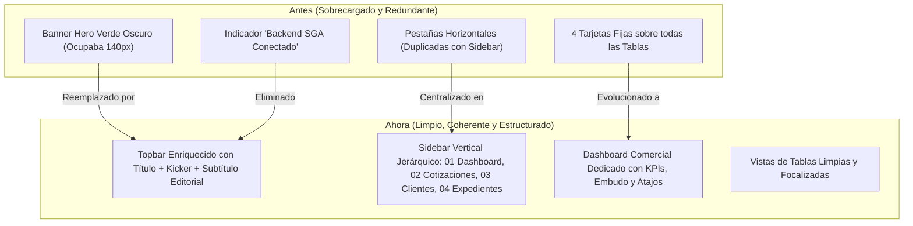

# Informe Técnico de Mejoras y Cambios en la UI Comercial (SGA)

**Proyecto:** SGA - Sistema de Gestión Aduanera  
**Módulo:** Recepción Comercial (Ventas & Operaciones Aduaneras)  
**Fecha:** Octubre 2026  
**Estado:** Implementado y Validado en Producción  

---

## 1. Resumen Ejecutivo

El presente informe documenta las optimizaciones de interfaz de usuario (UI) y experiencia de usuario (UX) implementadas en el módulo de **Recepción Comercial**, respondiendo a la necesidad de eliminar redundancias visuales, crear un centro de mando analítico (Dashboard Comercial) para ventas, suprimir elementos obstructivos de la cabecera e institucionalizar los lineamientos del nuevo **Lenguaje de Diseño SGA**.



---

## 2. Diagnóstico Previo y Oportunidades de Mejora

| Elemento Previo | Inconsistencia / Problema Detectado | Solución Aplicada |
| :--- | :--- | :--- |
| **Hero Banner Card** | Bloque verde oscuro de gran altura que restaba visibilidad vertical a las tablas operativas y generaba ruido cromático no alineado a la paleta cálida editorial. | **Eliminado de la vista.** Su contenido descriptivo y contextual fue trasladado e integrado sutilmente a la barra superior (`app-topbar`), agrandando el título de forma elegante y limpia. |
| **Duplicidad de Navegación** | Los botones `Cotizaciones`, `Clientes & Prospectos` y `Expedientes Aduaneros` coexistían tanto en el sidebar vertical izquierdo como en una barra de pestañas horizontal en la vista. | **Eliminada la barra de pestañas de la vista.** Ahora la navegación reside exclusivamente en la barra lateral vertical (`AppSidebar.vue`), simplificando el flujo mental del operador. |
| **Indicador Backend SGA** | Un badge verde fijo ("Backend SGA Conectado") ocupaba espacio en el topbar sin valor operativo diario para el usuario comercial. | **Eliminado completamente** del header. |
| **Estadísticas dispersas** | Las tarjetas métricas estaban montadas sobre la tabla de cotizaciones, interrumpiendo el flujo de consulta de registros. | **Centralizadas en un Dashboard Comercial exclusivo**, enriquecido con métricas de ventas, volumen en USD, embudo de conversión y desglose por régimen aduanero. |
| **Atajos Rápidos** | Los botones `+ Nueva Cotización` y `+ Nuevo Cliente` estaban dispersos o en el pie del sidebar. | **Trasladados al Dashboard Comercial** en una barra de atajos rápidos prominente, accesible en un clic sin saturar el menú vertical. |

---

## 3. Detalle de Modificaciones Técnicas y Visuales

### 3.1. Creación del "Dashboard Comercial de Ventas"
Se introdujo una nueva sub-opción dedicada: **01 Dashboard Comercial** en [RecepcionComercialView.vue](file:///home/jiodev/Documents/Proyects/SGA/frontend/src/features/roles-modules/views/RecepcionComercialView.vue):

1. **Barra de Atajos de Acción Comercial (`.dashboard-action-toolbar`):**
   - **`+ Nueva Cotización`**: Botón primario Espresso para abrir de inmediato el asistente de cotización aduanera en 5 pasos.
   - **`+ Nuevo Cliente`**: Botón secundario para registrar clientes o prospectos calificados.
   - **`Bandeja Cotizaciones`**, **`Directorio Clientes`** y **`Expedientes`**: Enlaces de salto directo entre sub-opciones.
   - **`Refrescar Datos`**: Control para forzar recarga sincrónica con estado de carga animado.

2. **Matriz de 6 Indicadores Clave de Desempeño (KPIs):**
   - **01 Cotizaciones Emitidas:** Conteo total histórico y volumen cotizado acumulado en dólares (`$ USD`).
   - **02 Propuestas Aprobadas:** Tasa de conversión porcentual (`%`) y recaudación por concepto de anticipos confirmados.
   - **03 Propuestas Pendientes:** Volumen de ofertas en evaluación o espera de respuesta del cliente.
   - **04 Propuestas Observadas:** Alerta destacada en tono ámbar/danger para cotizaciones observadas por supervisión aduanera que requieren corrección prioritaria.
   - **05 Cartera de Clientes:** Segmentación de clientes efectivos formalizados vs. prospectos calificados.
   - **06 Expedientes Operativos:** Trámites aduaneros activos enlazados con cotizaciones del área comercial.

3. **Paneles Analíticos de Pipeline y Distribución Operativa:**
   - **Embudo de Conversión de Cotizaciones:** Barra de progreso segmentada multi-estado (Aprobadas, Pendientes, Observadas, Rechazadas) y cálculo de **Ticket Promedio**.
   - **Desglose por Régimen Aduanero:** Distribución de propuestas según Importación Definitiva, Exportación Definitiva, Admisiones y Tránsitos, con conteos y montos cotizados en moneda extranjera.

4. **Registro de Actividad Comercial Reciente:**
   - Tabla compacta con las últimas 5 cotizaciones emitidas, estado con etiquetas semánticas y botones de acceso directo a la documentación adjunta y edición.

---

### 3.2. Integración en la Barra Superior (Topbar)
En [AppLayout.vue](file:///home/jiodev/Documents/Proyects/SGA/frontend/src/core/layouts/AppLayout.vue):
- **Sustitución del Banner:** Se rediseñó el sector izquierdo (`.topbar-left`) incorporando:
  - **Miga de pan contextual:** `SGA / Recepción Comercial`.
  - **Kicker de módulo:** `PANEL COMERCIAL // INTELIGENCIA DE VENTAS` o `PROPUESTAS ADUANERAS // EMISIÓN & SEGUIMIENTO`.
  - **Título de página refinado:** Agrandado sutilmente a `1.4rem` con `letter-spacing: -0.015em` y peso `700`.
  - **Subtítulo editorial descriptivo:** Explica el alcance de la sección activa, supliendo completamente la función del antiguo banner intrusivo.
- **Eliminación del Botón Backend:** Se removió el elemento `.system-status-indicator`.
- **Preservación de Proporciones:** La insignia de sede asignada y el perfil de usuario se mantuvieron intactos en sus dimensiones estándar, evitando cualquier sobredimensionamiento.

---

### 3.3. Reestructuración del Sidebar Vertical
En [AppSidebar.vue](file:///home/jiodev/Documents/Proyects/SGA/frontend/src/shared/components/AppSidebar.vue) y [navigationStore.js](file:///home/jiodev/Documents/Proyects/SGA/frontend/src/core/stores/navigationStore.js):
- Se reordenaron las sub-opciones del módulo de Recepción Comercial:
  - **`01 Dashboard Comercial`** (Sub-opción inicial por defecto)
  - **`02 Cotizaciones`** (Listado maestro y emisión)
  - **`03 Clientes & Prospectos`** (Directorio de cartera)
  - **`04 Expedientes Aduaneros`** (Seguimiento operativo)
- Se eliminaron los botones repetitivos de acción rápida del menú lateral, delegando dicha función al nuevo toolbar del Dashboard.

---

## 4. Impacto en la Experiencia de Usuario (UX)

```
[Flujo Anterior]
Usuario entra -> Ve Banner verde gigante -> Baja la pantalla -> Ve 4 métricas fijas ->
Ve pestañas duplicadas -> Se confunde entre Sidebar y pestañas -> Tablas con poco espacio vertical.

[Flujo Nuevo Optimizado]
Usuario entra -> Header limpio con título y contexto claro -> Dashboard comercial con KPIs y atajos ->
Un clic en "+ Nueva Cotización" o salto a listados maestros mediante Sidebar vertical.
```

- **Aumento del área útil de pantalla:** Se recuperaron más de 160 píxeles verticales en todas las vistas de tablas.
- **Eliminación de redundancias cognitivas:** El operador no duda entre interactuar con la barra lateral o con pestañas internas.
- **Enfoque analítico y gerencial:** El área comercial cuenta con visibilidad instantánea del volumen cotizado, ratio de conversión y montos pendientes de anticipo.

---

## 5. Verificación de Compilación y Calidad

- **Build de Producción:** Ejecutado satisfactoriamente con Vite v8.3.4 en **417 ms** con 0 errores de compilación (`dist/index.html` generado correctamente).
- **Consistencia de Temas:** El Dashboard Comercial y los componentes actualizados responden nativamente al alternador de Modo Claro / Modo Oscuro.
