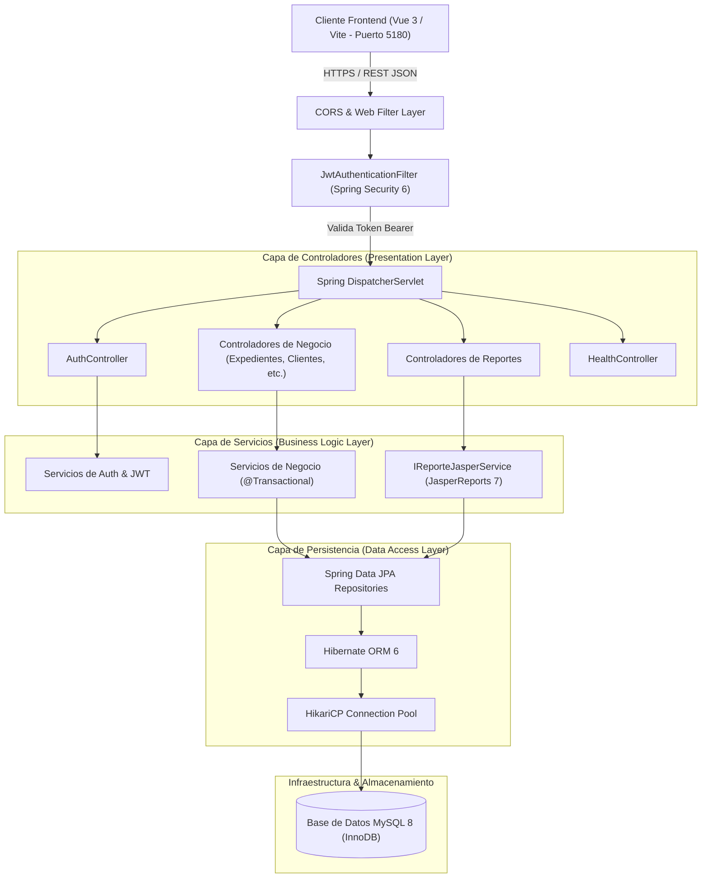
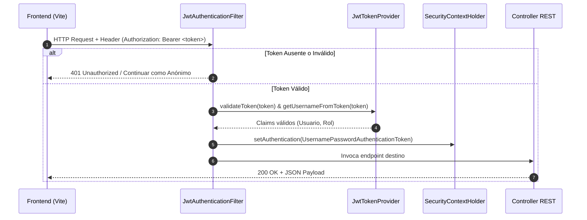
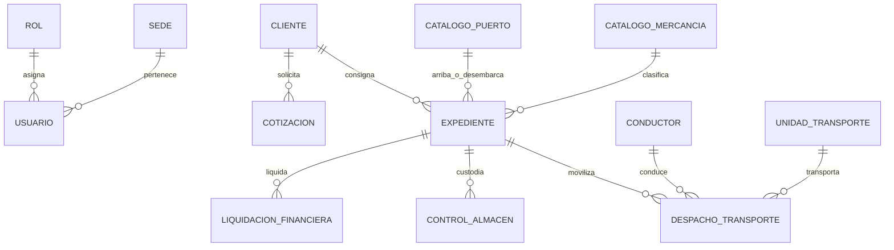

# Arquitectura Técnica General del Backend (SGA)

Este documento detalla la arquitectura técnica, los patrones de diseño, los diagramas de flujo y las decisiones de ingeniería implementadas en el backend del **Sistema de Gestión Aduanera (SGA)** (`sga-backend`).

---

## 1. Visión General de la Arquitectura

El backend del SGA está diseñado bajo el patrón de **Arquitectura en Capas (Layered / N-Tier Architecture)** desacoplada, orientada a microservicios o monolito modular de alto rendimiento, siguiendo el principio de responsabilidad única (SRP) y separación de preocupaciones (SoC).



---

## 2. Desglose de las Capas Arquitecturales

### A. Capa de Seguridad y Filtros Transversales
* **Punto de entrada:** Antes de alcanzar cualquier controlador, cada petición HTTP atraviesa la cadena de filtros de Spring Security (`SecurityFilterChain`).
* **Mecanismos clave:**
  1. **[`CorsConfig.java`](file:///home/jiodev/Documents/Proyects/SGA/backend/src/main/java/pe/sga/config/CorsConfig.java):** Configura los orígenes cruzados permitidos, métodos HTTP (`GET`, `POST`, `PUT`, `DELETE`, `OPTIONS`) y cabeceras autorizadas.
  2. **[`JwtAuthenticationFilter.java`](file:///home/jiodev/Documents/Proyects/SGA/backend/src/main/java/pe/sga/config/JwtAuthenticationFilter.java):** Interceptor que hereda de `OncePerRequestFilter`. Inspecciona el encabezado `Authorization: Bearer <token>`.
  3. **[`JwtTokenProvider.java`](file:///home/jiodev/Documents/Proyects/SGA/backend/src/main/java/pe/sga/config/JwtTokenProvider.java):** Verifica la integridad y firma criptográfica HMAC-SHA256 del token JWT, extrayendo el nombre de usuario y roles, e inyectando la identidad en el `SecurityContextHolder`.
  4. **Modo Stateless:** La sesión no se almacena en memoria de servidor (`SessionCreationPolicy.STATELESS`), lo que permite escalabilidad horizontal y balanceo de carga sin afinidad de sesiones.



---

### B. Capa de Presentación (REST Controllers)
* **Paquete:** `pe.sga.controller`
* **Características:**
  * **Estandarización RESTful:** Rutas versionadas bajo `/api/v1/...`.
  * **Tipado estricto con DTOs:** Ninguna entidad JPA de persistencia es expuesta directamente en los endpoints de mutación para evitar sobreexposición de datos (*Over-posting* o *Mass Assignment*).
  * **Validación Declarativa:** Uso de `@Valid` y anotaciones Jakarta Validation (`@NotNull`, `@NotBlank`, `@Size`, etc.).

---

### C. Capa de Lógica de Negocio (Service Layer)
* **Paquete:** `pe.sga.service` y `pe.sga.service.impl`
* **Patrón Interface-Driven:** Cada servicio se define mediante una interfaz (`IExpedienteService`, `IUsuarioService`, `IReporteJasperService`) y su respectiva clase de implementación (`ExpedienteServiceImpl`, etc.).
* **Transaccionalidad (ACID):**
  * `@Transactional(readOnly = true)` para operaciones de consulta, optimizando las lecturas en Hibernate al deshabilitar el dirty-checking en el contexto de persistencia.
  * `@Transactional` para operaciones de escritura (creación, edición y anulación) garantizando atomicidad y rollback automático en caso de excepciones no controladas.

---

### D. Motor de Generación de Reportes (JasperReports Engine)
* **Arquitectura de diseño programático:**
  * En lugar de cargar archivos `.jrxml` del sistema de archivos, el servicio [`ReporteJasperServiceImpl.java`](file:///home/jiodev/Documents/Proyects/SGA/backend/src/main/java/pe/sga/service/impl/ReporteJasperServiceImpl.java) genera los reportes de manera dinámica en memoria utilizando la API de bajo nivel `JasperDesign`.
  * **Optimización por Caché (*Double-Checked Locking*):** La compilación de reportes de JasperReports es costosa a nivel de CPU. El backend implementa variables `volatile` estáticas (`cachedUsuariosReport`, `cachedSedesReport`, `cachedPuertosReport`) con bloques sincronizados para compilar una única vez y reutilizar la definición compilada en subsecuentes descargas.
  * **Flujo del pipeline de reportes:**
    1. Lectura de entidades vía `Repository.findAll()`.
    2. Transformación a DTOs planos (`UsuarioReporteItemDTO`, `SedeReporteItemDTO`, etc.).
    3. Construcción del `JRBeanCollectionDataSource`.
    4. Relleno del reporte mediante `JasperFillManager.fillReport(report, params, dataSource)`.
    5. Exportación a arreglo de bytes con `JasperExportManager.exportReportToPdf(print)`.
    6. Respuesta en streaming HTTP como `ByteArrayInputStream` con `Content-Type: application/pdf`.

---

### E. Capa de Acceso a Datos (Persistence & ORM)
* **Paquete:** `pe.sga.repository` y `pe.sga.entity`
* **Tecnología:** Spring Data JPA + Hibernate ORM.
* **Características:**
  * Las interfaces extienden de `JpaRepository<T, ID>`, disponiendo de paginación, ordenamiento y métodos de consulta derivados (`findByUsername`, `existsByEmail`, etc.).
  * **Mapeo Relacional de Dominio Aduanero:**
    * `Usuario` ↔ `Rol` (ManyToOne)
    * `Usuario` ↔ `Sede` (ManyToOne)
    * `Expediente` ↔ `Cliente` (ManyToOne)
    * `Expediente` ↔ `CanalSunat` (Enum: `VERDE`, `NARANJA`, `ROJO`)
    * `Expediente` ↔ `EstadoExpediente` (Enum: `REGISTRADO`, `EN_TRAMITE`, `LEVANTE_AUTORIZADO`, `FINALIZADO`)
    * `DespachoTransporte` ↔ `UnidadTransporte` & `Conductor`
    * `ControlAlmacen` (Depósito y control de mercancías)
    * `LiquidacionFinanciera` (Aranceles, IGV, percepciones e impuestos)

---

### F. Manejo Global de Excepciones y Resiliencia
* **Componente:** [`GlobalExceptionHandler.java`](file:///home/jiodev/Documents/Proyects/SGA/backend/src/main/java/pe/sga/exception/GlobalExceptionHandler.java)
* **Patrón:** Interceptor centralizado `@RestControllerAdvice`.
* **Respuestas normalizadas:**

```json
{
  "timestamp": "2026-10-15T14:30:00",
  "status": 404,
  "error": "Not Found",
  "message": "Usuario con ID 99 no encontrado",
  "path": "/api/v1/usuarios/99"
}
```

---

## 3. Modelo de Dominio y Relaciones de Entidades



---

## 4. Estrategia de Inicialización y Semillero de Datos

El backend incluye [`DataInitializer.java`](file:///home/jiodev/Documents/Proyects/SGA/backend/src/main/java/pe/sga/config/DataInitializer.java), el cual implementa `CommandLineRunner`:
1. Se ejecuta inmediatamente después de levantar el contexto de Spring Boot.
2. Comprueba si los roles indispensables (`ADMIN`, `OPERADOR_ADUANAS`, `SUPERVISOR`, `LIQUIDADOR`, `CLIENTE`) existen en la tabla `roles`; si no, los crea.
3. Verifica la existencia de una sede central (`Sede Callao Principal`).
4. Genera al superusuario `admin` con contraseña encriptada con BCrypt (`admin123` o configurada) asignándole el rol `ADMIN`.
5. Siembra catálogos aduaneros de prueba si la base de datos está recién inicializada.

---

## 5. Decisiones Arquitecturales Clave (ADRs)

| Decisión | Opción Elegida | Justificación / Beneficio |
| :--- | :--- | :--- |
| **Autenticación** | Stateless JWT (JJWT) | Evita estado en el servidor; desacopla completamente el frontend en Vite del backend en Spring Boot y habilita escalabilidad horizontal. |
| **Generación PDF** | JasperReports vía código Java | Elimina dependencias de archivos `.jrxml` en disco que causan problemas de rutas en empaquetados JAR/WAR, acelerando la generación y facilitando el mantenimiento. |
| **Control de Acceso** | RBAC a nivel de Filtro y Endpoint | Seguridad perimetral donde cada endpoint restringe por roles autorizados en tiempo de ejecución. |
| **Conexiones a BD** | HikariCP Connection Pool | Ofrece la menor latencia y mayor concurrencia disponible en el ecosistema Java. |
| **Caché de Reportes** | Double-Checked Locking Volatile | Optimiza el consumo de CPU en el servidor al evitar recompilar plantillas JasperReports en cada descarga. |
