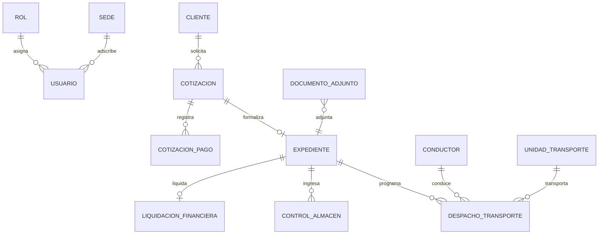

# Guía Maestra de Base de Datos e Infraestructura
**Transaduanas Platform (Powered by SGA Core)**  
*Arquitectura de Datos, Modelado Relacional 3NF y Secuencia de Commits Git para el Mantenedor / DBA (Persona 1)*

---

## 1. Visión General y Arquitectura de Base de Datos

La base de datos de **Transaduanas Platform** está construida sobre el motor relacional **MySQL 8.4 InnoDB**, estructurada bajo la **Tercera Forma Normal (3NF)** para garantizar atomicidad, integridad referencial y cero redundancia en las operaciones de comercio exterior y agenciamiento aduanero.

```
┌────────────────────────────────────────────────────────────────────────┐
│             ARQUITECTURA DE DATOS: 16 TABLAS RELACIONALES (3NF)        │
└────────────────────────────────────────────────────────────────────────┘

 [1. CATÁLOGOS AUXILIARES]
  ├── catalogo_puerto          (Puertos marítimos, aéreos y terrestres)
  ├── catalogo_tipo_carga       (Contenedor FCL/LCL, Carga Suelta, Granel)
  └── catalogo_mercancia        (Partidas arancelarias y descripción)

 [2. IDENTIDAD Y CONTROL DE ACCESO (RBAC)]
  ├── rol                       (8 roles normativos institucionales)
  ├── sede                      (Callao, Paita, Matarani)
  └── usuario                   (Credenciales BCrypt, tokens y datos personales)

 [3. DOMINIO COMERCIAL Y PRE-PAGO]
  ├── cliente                   (Razón social, RUC/DNI, contacto comercial)
  ├── cotizacion                (Flete marítimo, terrestre, seguro, total proforma)
  └── cotizacion_pago           (Comprobante de abono bancario y validación CONTADOR)

 [4. OPERACIONES ADUANERAS Y ALMACÉN]
  ├── expediente                (Número DAM de 18 dígitos, aduana, canal SUNAT V/N/R)
  ├── control_almacen           (Balanza pesaje VGM, tara, neto, estiba)
  └── documento_adjunto         (Archivo polimórfico de PDFs: DUA, guías, tickets)

 [5. LOGÍSTICA DE TRANSPORTE Y FINANZAS]
  ├── conductor                 (Licencia MTC, récord de tránsito)
  ├── unidad_transporte         (Placa tracto, placa carreta, configuración MTC)
  ├── despacho_transporte       (Ruta programada, salida, eventos, entrega final)
  └── liquidacion_financiera    (Cálculo tributario, IGV, detracción SPOT Banco Nación)
```

### 1.1 Principios de Modelado y Persistencia

1. **Codificación y Zona Horaria:**  
   * **Charset:** `utf8mb4` con colación `utf8mb4_unicode_ci` para soporte de caracteres internacionales, tildes y símbolos.
   * **Zona Horaria:** Configurada explícitamente en `-05:00` (Hora Estándar del Perú / PET) tanto en el motor MySQL como en la conexión JDBC de Spring Boot.
2. **Borrado Lógico Transversal (`estado_activo`):**  
   Ningún registro de negocio (usuarios, clientes, cotizaciones, expedientes, conductores) es eliminado físicamente de la base de datos (`DROP` o `DELETE CASCADE`). Todas las tablas incorporan la columna:
   ```sql
   estado_activo TINYINT(1) NOT NULL DEFAULT 1
   ```
   Esto asegura trazabilidad legal y auditoría histórica inalterable requerida por SUNAT y aduanas.
3. **Integridad Referencial con Restricción Estricta:**  
   Todas las llaves foráneas (`FOREIGN KEY`) emplean `ON UPDATE CASCADE ON DELETE RESTRICT`, impidiendo que se elimine accidentalmente un cliente con cotizaciones asociadas, o una cotización vinculada a un expediente.
4. **Compuerta de Negocio Reflejada en Datos:**  
   La tabla `cotizacion` posee la columna `tiene_pago_aprobado TINYINT(1) NOT NULL DEFAULT 0`. La creación de un registro en `expediente` exige que la cotización foránea referenciada tenga dicho valor en `1`.

---

### 1.2 Diagrama Entidad-Relación Consolidado (ERD)



---

## 2. Rol y Responsabilidades del Mantenedor / DBA (Persona 1)

El **Ingeniero 1 (Mantenedor / DevOps / DBA)** tiene a su cargo la gobernanza técnica de la infraestructura y el control de versiones:

1. **Gobernanza del Repositorio:** Creación de las ramas `main` y `develop`, configuración de reglas de protección, branches por rol (`infra/*`, `backend/*`, `frontend/*`) y resolución de Pull Requests.
2. **Entorno Contenerizado:** Configuración y mantenimiento del contenedor MySQL 8.4 (Podman o Docker) con volúmenes persistentes y credenciales aisladas.
3. **Arquitectura del Esquema SQL:** Redacción, optimización e indexación de `schema.sql` y datos semilla `data.sql`.
4. **Garantía de Disponibilidad:** Asegurar que la base de datos esté levantada y poblada antes de que el Ingeniero de Backend (Persona 2) inicie la conexión de Spring Boot.

---

## 3. Recreación Paso a Paso con Commits (Rama `infra/*`)

A continuación se detalla la secuencia exacta de commits para inicializar el proyecto, levantar la base de datos y proveer los cimientos para el resto del equipo:

```
[main] ─────────────────────────────────────────────────────────────●
  │
  ▼
[develop]
  │
  └──► [infra/setup-database-environment]
          │
          ├── Commit 1: Inicialización del repositorio y estructura
          ├── Commit 2: Docker compose y variables de entorno
          ├── Commit 3: Esquema DDL relacional (16 tablas 3NF)
          ├── Commit 4: Datos semilla (roles, sedes, admin)
          └── Commit 5: Scripts de verificación y health check
```

---

### Commit 1: Inicialización del Repositorio y Estructura Raíz

**Objetivo:** Crear el repositorio Git con la estructura de carpetas estándar y políticas de exclusión (`.gitignore`).

#### 1. Comandos de terminal:
```bash
# Inicializar repositorio Git y ramas base
git init
git checkout -b main
git commit --allow-empty -m "chore: initial commit en main"
git checkout -b develop

# Crear rama de especialidad para infraestructura
git checkout -b infra/setup-database-environment

# Crear estructura de carpetas
mkdir -p database/backups
mkdir -p backend
mkdir -p frontend
```

#### 2. Crear archivo `.gitignore` en la raíz del proyecto:
```gitignore
# Archivos de sistema y logs
*.log
.DS_Store
Thumbs.db

# Configuración local de base de datos y credenciales
application-local.properties
backend/application-local.properties
.env
*.env.local

# Maven / Java
target/
pom.xml.tag
pom.xml.releaseBackup
pom.xml.versionsBackup
pom.xml.next
release.properties
.mvn/wrapper/maven-wrapper.jar

# Node / Vue / Vite
node_modules/
dist/
dist-ssr/
*.local

# IDEs
.idea/
.vscode/
*.iml
*.sublime-project
*.sublime-workspace
```

#### 3. Comando Git:
```bash
git add .gitignore
git commit -m "chore(infra): inicializar estructura de repositorio, ramas develop/main y archivo gitignore"
```

---

### Commit 2: Contenedor MySQL 8.4 y Variables de Entorno

**Objetivo:** Orquestar el servicio de base de datos MySQL 8.4 InnoDB con Podman/Docker y documentar las variables de conexión.

#### 1. Crear el archivo `database/docker-compose.yml`:
```yaml
services:
  mysql:
    image: docker.io/library/mysql:8.4
    container_name: sga-mysql
    restart: unless-stopped
    command:
      - --character-set-server=utf8mb4
      - --collation-server=utf8mb4_unicode_ci
      - --default-time-zone=-05:00
    environment:
      MYSQL_ROOT_PASSWORD: root
      MYSQL_DATABASE: SGAdb
      MYSQL_USER: root
      MYSQL_PASSWORD: root
    ports:
      - "3306:3306"
    volumes:
      - sga-mysql-data:/var/lib/mysql

volumes:
  sga-mysql-data:
    name: sga-mysql-data
```

#### 2. Crear archivo de ejemplo de variables locales `backend/application-local.properties.example`:
```properties
# Ejemplo de configuración local para desarrollo (copiar a application-local.properties)
SERVER_PORT=8085
DB_URL=jdbc:mysql://localhost:3306/SGAdb?useSSL=false&serverTimezone=America/Lima&allowPublicKeyRetrieval=true
DB_USERNAME=root
DB_PASSWORD=root
JPA_DDL_AUTO=update
JPA_SHOW_SQL=true
JWT_SECRET=sga_platform_secret_key_super_segura_2026_jwt_token_auth
STORAGE_DIR=./uploads/documentos
```

#### 3. Comando Git:
```bash
git add database/docker-compose.yml backend/application-local.properties.example
git commit -m "feat(infra): configurar docker-compose para mysql 8.4 inno-db y plantilla de conexion local"
```

---

### Commit 3: Esquema DDL Relacional Completo (16 Tablas en 3NF)

**Objetivo:** Redactar el archivo `database/schema.sql` conteniendo la definición estricta de tablas, claves primarias autoincrementales, llaves foráneas e índices.

#### 1. Crear el archivo `database/schema.sql`:
*Copiar de `database/schema.sql` del proyecto actual.*  
Asegurar que incluya las 16 tablas en el orden correcto para respetar la integridad referencial:
1. `catalogo_puerto`
2. `catalogo_tipo_carga`
3. `catalogo_mercancia`
4. `rol`
5. `sede`
6. `usuario`
7. `cliente`
8. `cotizacion`
9. `cotizacion_pago`
10. `expediente`
11. `control_almacen`
12. `conductor`
13. `unidad_transporte`
14. `despacho_transporte`
15. `liquidacion_financiera`
16. `documento_adjunto`

#### 2. Comando Git:
```bash
git add database/schema.sql
git commit -m "feat(database): implementar esquema ddl relacional de 16 tablas normalizadas en 3nf"
```

---

### Commit 4: Datos Semilla Normativos (Roles, Sedes y Administrador)

**Objetivo:** Redactar el script `database/data.sql` con los datos basales obligatorios para el arranque del sistema.

#### 1. Crear el archivo `database/data.sql`:
```sql
USE SGAdb;

-- 1. Sembrado de los 8 Roles Institucionales
INSERT INTO rol (id_rol, nombre_rol, descripcion, nivel_acceso, estado_activo) VALUES
(1, 'ADMINISTRADOR_TI', 'Administrador de Tecnologías de Información con acceso total al sistema', 1, 1),
(2, 'GERENTE_GENERAL', 'Gerente General con facultades de supervisión global y fiscalización', 2, 1),
(3, 'AGENTE_COMERCIAL', 'Ejecutivo Comercial encargado de prospección, clientes y cotizaciones', 3, 1),
(4, 'SUPERVISOR_ADUANERO', 'Supervisor de Operaciones Aduaneras, numeración DAM y canales SUNAT', 3, 1),
(5, 'AGENTE_ADUANERO', 'Agente de campo encargado de aforo físico y tramitación aduanera', 4, 1),
(6, 'SUPERVISOR_TRANSPORTE', 'Coordinador de Flota Terrestre, asignación de tractos y monitoreo', 3, 1),
(7, 'CONTADOR', 'Responsable de Finanzas, validación de pre-pagos y liquidaciones SPOT', 3, 1),
(8, 'ASESOR_LEGAL', 'Asesor Jurídico encargado de auditoría técnica y dictámenes normativos', 3, 1)
ON DUPLICATE KEY UPDATE nombre_rol = VALUES(nombre_rol);

-- 2. Sedes Operativas Principales
INSERT INTO sede (id_sede, codigo_sede, nombre_sede, direccion, distrito, telefono, estado) VALUES
(1, 'SED-CALLAO', 'Sede Central Callao (Puerto Marítimo)', 'Av. Manco Cápac 250', 'Callao', '+51 1 429 8800', 'OPERATIVO'),
(2, 'SED-PAITA', 'Sede Norte Paita', 'Zona Industrial II Mz. B Lt. 4', 'Paita', '+51 73 211 400', 'OPERATIVO'),
(3, 'SED-MATARANI', 'Sede Sur Matarani', 'Av. Panamericana Sur Km 1040', 'Islay', '+51 54 532 100', 'OPERATIVO')
ON DUPLICATE KEY UPDATE nombre_sede = VALUES(nombre_sede);

-- 3. Catálogo de Tipos de Carga
INSERT INTO catalogo_tipo_carga (id_tipo_carga, codigo, nombre, estado) VALUES
(1, 'FCL-20', 'Contenedor Estándar 20 Pies (FCL)', 'ACTIVO'),
(2, 'FCL-40', 'Contenedor Estándar 40 Pies (FCL)', 'ACTIVO'),
(3, 'FCL-40HC', 'Contenedor High Cube 40 Pies (FCL)', 'ACTIVO'),
(4, 'LCL', 'Carga Consolidada Suelta (LCL)', 'ACTIVO'),
(5, 'GRANEL', 'Carga a Granel Marítima', 'ACTIVO')
ON DUPLICATE KEY UPDATE nombre = VALUES(nombre);

-- 4. Catálogo de Puertos Base
INSERT INTO catalogo_puerto (id_puerto, codigo_puerto, nombre, pais, tipo, estado) VALUES
(1, 'PECAL', 'Puerto del Callao (APM Terminals / DP World)', 'PERU', 'MARITIMO', 'ACTIVO'),
(2, 'PEPAI', 'Puerto de Paita (TPE)', 'PERU', 'MARITIMO', 'ACTIVO'),
(3, 'PEMAT', 'Puerto de Matarani (TISUR)', 'PERU', 'MARITIMO', 'ACTIVO'),
(4, 'CNSHA', 'Puerto de Shanghai', 'CHINA', 'MARITIMO', 'ACTIVO'),
(5, 'USMIA', 'Puerto de Miami', 'ESTADOS UNIDOS', 'MARITIMO', 'ACTIVO')
ON DUPLICATE KEY UPDATE nombre = VALUES(nombre);

-- 5. Usuario Administrador Inicial (Password: Password123!)
INSERT INTO usuario (
    id_usuario, id_rol, id_sede, username, password_hash, nombres, apellidos,
    correo_institucional, tipo_documento, numero_documento, telefono, cargo_titulo,
    codigo_sunat, estado_activo
) VALUES (
    1, 1, 1, 'admin',
    '$2a$10$7zBv4l8Yx8fD7T1fJ9m5uO7eYqJk9FzD3c4X5A6b7C8d9E0f1G2h3',
    'Administrador', 'Sistema TI', 'admin@transaduanas.pe', 'DNI', '00000000',
    '+51 999 999 999', 'Administrador de TI', 'SUNAT-ADMIN', 1
)
ON DUPLICATE KEY UPDATE username = VALUES(username);
```

#### 2. Comando Git:
```bash
git add database/data.sql
git commit -m "feat(database): incorporar datos semilla de roles normativos, sedes, catalogos y usuario admin"
```

---

### Commit 5: Scripts de Verificación y Protocolo de Merge a `develop`

**Objetivo:** Probar el levantamiento físico del contenedor, la carga del esquema e integrar los cambios hacia la rama troncal `develop`.

#### 1. Probar el arranque local:
```bash
# Levantar contenedor MySQL
docker compose -f database/docker-compose.yml up -d
# O con Podman:
podman compose -f database/docker-compose.yml up -d

# Esperar 5 segundos y cargar el esquema y las semillas
mysql -h 127.0.0.1 -P 3306 -u root -proot SGAdb < database/schema.sql
mysql -h 127.0.0.1 -P 3306 -u root -proot SGAdb < database/data.sql

# Verificar conteo de tablas
mysql -h 127.0.0.1 -P 3306 -u root -proot SGAdb -e "SHOW TABLES;"
```
*Resultado esperado:* 16 tablas listadas y 8 roles en la tabla `rol`.

#### 2. Integrar rama a `develop`:
```bash
git checkout develop
git merge --no-ff infra/setup-database-environment -m "merge: integrar infraestructura base y base de datos relacional en develop"
git push origin develop
```

---

## 4. Guía de Ejecución y Monitoreo para el DBA

### Inspección Rápida de Integridad Referencial
Para auditar que las claves foráneas y compuertas de negocio estén activas:

```sql
-- 1. Verificar roles cargados
SELECT id_rol, nombre_rol, nivel_acceso, estado_activo FROM rol;

-- 2. Verificar que las cotizaciones tengan la bandera de pago
DESCRIBE cotizacion tiene_pago_aprobado;

-- 3. Verificar estado de conexiones activas
SHOW STATUS WHERE `variable_name` = 'Threads_connected';
```

---

## 5. Resumen de Entregables de la Base de Datos

Al concluir la labor del Ingeniero 1:
* Contenedor MySQL 8.4 operativo en puerto `3306`.
* Esquema `SGAdb` con **16 tablas relacionales** en 3NF.
* Semillas normativas sembradas (8 roles institucionales, sedes y catálogos).
* Repositorio Git centralizado con ramas `main`, `develop` y `.gitignore` listo para que el Ingeniero de Backend (Persona 2) y el Ingeniero de Frontend (Persona 3) comiencen su desarrollo en paralelo.
