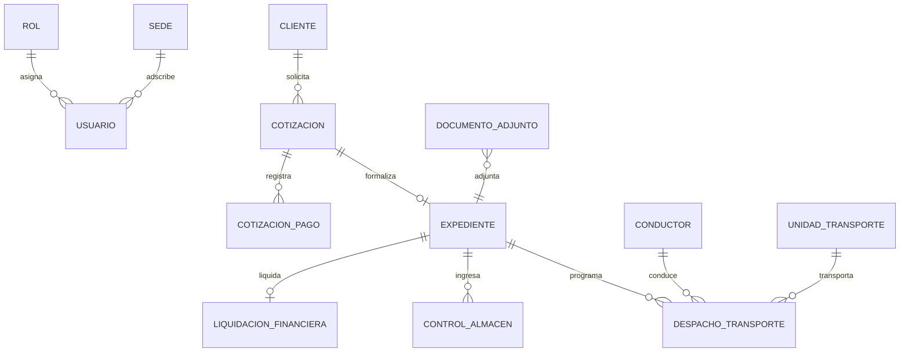

# Guía Maestra de Base de Datos y Modelado Relacional (3NF)
**Transaduanas Platform (Powered by SGA Core)**  
*Paso 1: Arquitectura de Datos, Modelado de 16 Tablas, Datos Semilla y Reglas de Negocio para el DBA (Persona 1)*

> [!NOTE]
> Esta guía asume que ya se completó la configuración inicial del repositorio, ramas y contenedor MySQL 8.4 descrita en **[`conf_inicial.md`](./conf_inicial.md)**.

---

## 1. Visión General y Arquitectura de Base de Datos

La base de datos de **Transaduanas Platform** está construida sobre el motor relacional **MySQL 8.4 InnoDB**, estructurada bajo la **Tercera Forma Normal (3NF)** para garantizar atomicidad, integridad referencial y cero redundancia en las operaciones de comercio exterior y agenciamiento aduanero.

```
┌────────────────────────────────────────────────────────────────────────┐
│             ARQUITECTURA DE DATOS: 16 TABLAS RELACIONALES (3NF)        │
└────────────────────────────────────────────────────────────────────────┘

 [1. CATÁLOGOS AUXILIARES]
  ├── catalogo_puerto          (Puertos marítimos, aéreos y terrestres)
  ├── catalogo_tipo_carga       (Contenedor FCL/LCL, Carga Suelta, Granel)
  └── catalogo_mercancia        (Partidas arancelarias y descripción)

 [2. IDENTIDAD Y CONTROL DE ACCESO (RBAC)]
  ├── rol                       (8 roles normativos institucionales)
  ├── sede                      (Callao, Paita, Matarani)
  └── usuario                   (Credenciales BCrypt, tokens y datos personales)

 [3. DOMINIO COMERCIAL Y PRE-PAGO]
  ├── cliente                   (Razón social, RUC/DNI, contacto comercial)
  ├── cotizacion                (Flete marítimo, terrestre, seguro, total proforma)
  └── cotizacion_pago           (Comprobante de abono bancario y validación CONTADOR)

 [4. OPERACIONES ADUANERAS Y ALMACÉN]
  ├── expediente                (Número DAM de 18 dígitos, aduana, canal SUNAT V/N/R)
  ├── control_almacen           (Balanza pesaje VGM, tara, neto, estiba)
  └── documento_adjunto         (Archivo polimórfico de PDFs: DUA, guías, tickets)

 [5. LOGÍSTICA DE TRANSPORTE Y FINANZAS]
  ├── conductor                 (Licencia MTC, récord de tránsito)
  ├── unidad_transporte         (Placa tracto, placa carreta, configuración MTC)
  ├── despacho_transporte       (Ruta programada, salida, eventos, entrega final)
  └── liquidacion_financiera    (Cálculo tributario, IGV, detracción SPOT Banco Nación)
```

### 1.1 Principios de Modelado y Persistencia

1. **Codificación y Zona Horaria:**  
   * **Charset:** `utf8mb4` con colación `utf8mb4_unicode_ci` para soporte de caracteres internacionales, tildes y símbolos.
   * **Zona Horaria:** Configurada explícitamente en `-05:00` (Hora Estándar del Perú / PET) tanto en el motor MySQL como en la conexión JDBC de Spring Boot.
2. **Borrado Lógico Transversal (`estado_activo`):**  
   Ningún registro de negocio (usuarios, clientes, cotizaciones, expedientes, conductores) es eliminado físicamente de la base de datos (`DROP` o `DELETE CASCADE`). Todas las tablas incorporan la columna:
   ```sql
   estado_activo TINYINT(1) NOT NULL DEFAULT 1
   ```
   Esto asegura trazabilidad legal y auditoría histórica inalterable requerida por SUNAT y aduanas.
3. **Integridad Referencial con Restricción Estricta:**  
   Todas las llaves foráneas (`FOREIGN KEY`) emplean `ON UPDATE CASCADE ON DELETE RESTRICT`, impidiendo que se elimine accidentalmente un cliente con cotizaciones asociadas, o una cotización vinculada a un expediente.
4. **Compuerta de Negocio Reflejada en Datos:**  
   La tabla `cotizacion` posee la columna `tiene_pago_aprobado TINYINT(1) NOT NULL DEFAULT 0`. La creación de un registro en `expediente` exige que la cotización foránea referenciada tenga dicho valor en `1`.

---

### 1.2 Diagrama Entidad-Relación Consolidado (ERD)



---

## 2. Secuencia de Commits de Base de Datos (Rama `infra/*`)

Continuando desde la rama `infra/setup-database-environment` iniciada tras el paso de configuración inicial:

```
[develop]
  │
  └──► [infra/setup-database-environment]
          │
          ├── Commit 1.1: Esquema DDL relacional (16 tablas en 3NF)
          ├── Commit 1.2: Datos semilla normativos (roles, sedes, catálogos, admin)
          └── Commit 1.3: Verificación de integridad y merge hacia develop
```

---

### Commit 1.1: Esquema DDL Relacional Completo (16 Tablas en 3NF)

**Objetivo:** Redactar y aplicar el archivo `database/schema.sql` conteniendo la definición estricta de tablas, claves primarias autoincrementales, llaves foráneas e índices.

#### 1. Crear el archivo `database/schema.sql`:
*Copiar de `database/schema.sql` del proyecto.*  
Asegurar el orden de creación estricto para satisfacer las restricciones referenciales:
1. `catalogo_puerto`
2. `catalogo_tipo_carga`
3. `catalogo_mercancia`
4. `rol`
5. `sede`
6. `usuario`
7. `cliente`
8. `cotizacion`
9. `cotizacion_pago`
10. `expediente`
11. `control_almacen`
12. `conductor`
13. `unidad_transporte`
14. `despacho_transporte`
15. `liquidacion_financiera`
16. `documento_adjunto`

#### 2. Comando Git:
```bash
git add database/schema.sql
git commit -m "feat(database): implementar esquema ddl relacional de 16 tablas normalizadas en 3nf"
```

---

### Commit 1.2: Datos Semilla Normativos (Roles, Sedes y Administrador)

**Objetivo:** Redactar el script `database/data.sql` con los datos basales obligatorios para el arranque del sistema.

#### 1. Crear el archivo `database/data.sql`:
```sql
USE SGAdb;

-- 1. Sembrado de los 8 Roles Institucionales
INSERT INTO rol (id_rol, nombre_rol, descripcion, nivel_acceso, estado_activo) VALUES
(1, 'ADMINISTRADOR_TI', 'Administrador de Tecnologías de Información con acceso total al sistema', 1, 1),
(2, 'GERENTE_GENERAL', 'Gerente General con facultades de supervisión global y fiscalización', 2, 1),
(3, 'AGENTE_COMERCIAL', 'Ejecutivo Comercial encargado de prospección, clientes y cotizaciones', 3, 1),
(4, 'SUPERVISOR_ADUANERO', 'Supervisor de Operaciones Aduaneras, numeración DAM y canales SUNAT', 3, 1),
(5, 'AGENTE_ADUANERO', 'Agente de campo encargado de aforo físico y tramitación aduanera', 4, 1),
(6, 'SUPERVISOR_TRANSPORTE', 'Coordinador de Flota Terrestre, asignación de tractos y monitoreo', 3, 1),
(7, 'CONTADOR', 'Responsable de Finanzas, validación de pre-pagos y liquidaciones SPOT', 3, 1),
(8, 'ASESOR_LEGAL', 'Asesor Jurídico encargado de auditoría técnica y dictámenes normativos', 3, 1)
ON DUPLICATE KEY UPDATE nombre_rol = VALUES(nombre_rol);

-- 2. Sedes Operativas Principales
INSERT INTO sede (id_sede, codigo_sede, nombre_sede, direccion, distrito, telefono, estado) VALUES
(1, 'SED-CALLAO', 'Sede Central Callao (Puerto Marítimo)', 'Av. Manco Cápac 250', 'Callao', '+51 1 429 8800', 'OPERATIVO'),
(2, 'SED-PAITA', 'Sede Norte Paita', 'Zona Industrial II Mz. B Lt. 4', 'Paita', '+51 73 211 400', 'OPERATIVO'),
(3, 'SED-MATARANI', 'Sede Sur Matarani', 'Av. Panamericana Sur Km 1040', 'Islay', '+51 54 532 100', 'OPERATIVO')
ON DUPLICATE KEY UPDATE nombre_sede = VALUES(nombre_sede);

-- 3. Catálogo de Tipos de Carga
INSERT INTO catalogo_tipo_carga (id_tipo_carga, codigo, nombre, estado) VALUES
(1, 'FCL-20', 'Contenedor Estándar 20 Pies (FCL)', 'ACTIVO'),
(2, 'FCL-40', 'Contenedor Estándar 40 Pies (FCL)', 'ACTIVO'),
(3, 'FCL-40HC', 'Contenedor High Cube 40 Pies (FCL)', 'ACTIVO'),
(4, 'LCL', 'Carga Consolidada Suelta (LCL)', 'ACTIVO'),
(5, 'GRANEL', 'Carga a Granel Marítima', 'ACTIVO')
ON DUPLICATE KEY UPDATE nombre = VALUES(nombre);

-- 4. Catálogo de Puertos Base
INSERT INTO catalogo_puerto (id_puerto, codigo_puerto, nombre, pais, tipo, estado) VALUES
(1, 'PECAL', 'Puerto del Callao (APM Terminals / DP World)', 'PERU', 'MARITIMO', 'ACTIVO'),
(2, 'PEPAI', 'Puerto de Paita (TPE)', 'PERU', 'MARITIMO', 'ACTIVO'),
(3, 'PEMAT', 'Puerto de Matarani (TISUR)', 'PERU', 'MARITIMO', 'ACTIVO'),
(4, 'CNSHA', 'Puerto de Shanghai', 'CHINA', 'MARITIMO', 'ACTIVO'),
(5, 'USMIA', 'Puerto de Miami', 'ESTADOS UNIDOS', 'MARITIMO', 'ACTIVO')
ON DUPLICATE KEY UPDATE nombre = VALUES(nombre);

-- 5. Usuario Administrador Inicial (Password: Password123!)
INSERT INTO usuario (
    id_usuario, id_rol, id_sede, username, password_hash, nombres, apellidos,
    correo_institucional, tipo_documento, numero_documento, telefono, cargo_titulo,
    codigo_sunat, estado_activo
) VALUES (
    1, 1, 1, 'admin',
    '$2a$10$7zBv4l8Yx8fD7T1fJ9m5uO7eYqJk9FzD3c4X5A6b7C8d9E0f1G2h3',
    'Administrador', 'Sistema TI', 'admin@transaduanas.pe', 'DNI', '00000000',
    '+51 999 999 999', 'Administrador de TI', 'SUNAT-ADMIN', 1
)
ON DUPLICATE KEY UPDATE username = VALUES(username);
```

#### 2. Comando Git:
```bash
git add database/data.sql
git commit -m "feat(database): incorporar datos semilla de roles normativos, sedes, catalogos y usuario admin"
```

---

### Commit 1.3: Carga, Verificación de Integridad y Merge a `develop`

**Objetivo:** Ejecutar físicamente los scripts DDL y DML sobre el contenedor MySQL, comprobar integridad e integrar hacia la rama `develop`.

#### 1. Cargar el esquema y las semillas en el contenedor:
```bash
# Cargar esquema relacional
mysql -h 127.0.0.1 -P 3306 -u root -proot SGAdb < database/schema.sql

# Cargar datos semilla
mysql -h 127.0.0.1 -P 3306 -u root -proot SGAdb < database/data.sql

# Verificar conteo de tablas y registros
mysql -h 127.0.0.1 -P 3306 -u root -proot SGAdb -e "SHOW TABLES; SELECT COUNT(*) AS total_roles FROM rol;"
```
*Resultado esperado:* 16 tablas listadas y `total_roles = 8`.

#### 2. Integrar rama a `develop`:
```bash
git checkout develop
git merge --no-ff infra/setup-database-environment -m "merge: integrar infraestructura base y base de datos relacional en develop"
git push origin develop
```

---

## 3. Guía de Ejecución y Monitoreo para el DBA

### Inspección Rápida de Integridad Referencial
Para auditar que las claves foráneas y compuertas de negocio estén activas:

```sql
-- 1. Verificar roles cargados
SELECT id_rol, nombre_rol, nivel_acceso, estado_activo FROM rol;

-- 2. Verificar que las cotizaciones tengan la bandera de pago
DESCRIBE cotizacion tiene_pago_aprobado;

-- 3. Verificar estado de conexiones activas
SHOW STATUS WHERE `variable_name` = 'Threads_connected';
```

---

## 4. Resumen de Entregables de la Base de Datos

Al concluir la labor del Ingeniero 1:
* Contenedor MySQL 8.4 operativo en puerto `3306`.
* Esquema `SGAdb` con **16 tablas relacionales** en 3NF.
* Semillas normativas sembradas (8 roles institucionales, sedes y catálogos).
* Repositorio Git centralizado con ramas `main`, `develop` y `.gitignore` listo para que el Ingeniero de Backend (Persona 2) y el Ingeniero de Frontend (Persona 3) comiencen su desarrollo en paralelo.
